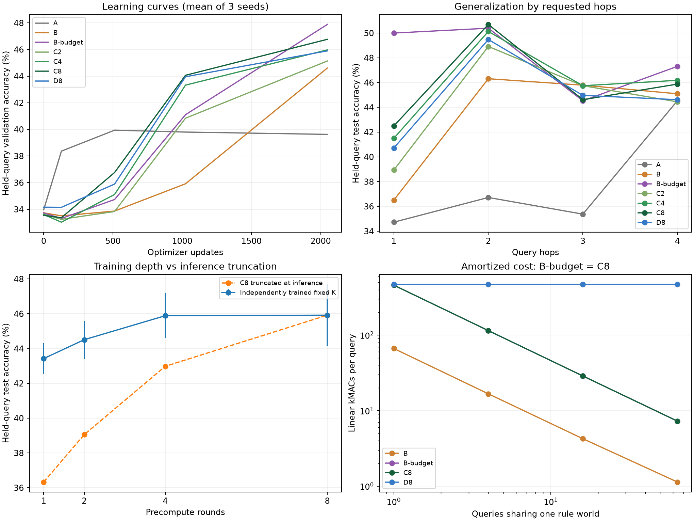
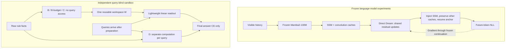

# WSR: State Reorganization & Reusable Computation

[](https://github.com/nijinhai/wsr-state-reorganization/actions/workflows/tests.yml)
[](LICENSE)
[](pyproject.toml)

[中文说明](README.zh-CN.md) · [Architecture](docs/WSR_ARCHITECTURE.md) · [Reproduce](docs/REPRODUCIBILITY.md) · [Research notes](docs/RESEARCH_OVERVIEW.md)

**Can extra recurrent computation form useful intermediate results—and can those results be reused before the model knows the query?**

An independent PyTorch research project tracing that question from differentiable state editing in frozen **Mamba2-130M** to controlled, CPU-sized rule sandboxes. The emphasis is on isolating **stored information, usable readout, computation, and cost**, with paired seeds, intervention tests, and explicit negative results.

## What this project contains

- **Differentiable state editing:** extract, modify and resume Mamba-2 SSM caches while preserving convolution caches and token alignment. Frozen weights still allow gradients to edited states.
- **Bottleneck diagnosis:** fact probes, oracle-input controls, query-decoder comparisons and 72 layer/history/horizon gradient cases.
- **Intermediate-computation experiments:** shared recurrent updates trained only from final answers; controlled evidence/state interventions in small tasks.
- **Reusable precomputation:** query-blind single-pass and recurrent models compared with a compute-matched wider baseline and query-conditioned computation.
- **Evidence:** per-seed tables, learning curves, figures, protocols and corrections. No pretrained weights or document bodies are bundled.

## Latest result: precomputation helps; recurrence has no unique generalization win

Six-node random directed rule graphs, balanced colors, 1–4-hop queries. Query-blind models prepare one workspace before seeing any queries. Every model uses the same lightweight query interface: select a start-node workspace vector, then apply a hop-selected linear classifier. Each recurrent update sees **all facts and the whole workspace**; the task is not constrained to one hop per round.

**7 configurations × 3 paired seeds × 2,048 updates.** Test rules are unseen; “seen” below refers only to the start/hop query combination. Values are mean ± sample SD across three seeds.

| Model | Parameters | Seen query combinations | Held-out combinations |
|---|---:|---:|---:|
| A: no precomputation | 396 | 37.61 ± 0.24% | 37.84 ± 0.15% |
| B = C1: single pass | 67,404 | 61.57 ± 0.30% | 43.42 ± 0.91% |
| B-budget: wider single pass | 460,748 | 63.52 ± 1.08% | **48.06 ± 1.29%** |
| C2: shared recurrent update | 67,404 | 62.70 ± 0.67% | 44.51 ± 1.10% |
| C4: shared recurrent update | 67,404 | 63.59 ± 0.85% | 45.89 ± 1.29% |
| C8: shared recurrent update | 67,404 | **64.43 ± 1.07%** | 45.92 ± 1.77% |
| D8: query-conditioned | 70,604 | 63.45 ± 0.13% | 44.94 ± 0.80% |

C8 improves over the parameter-matched single pass, but loses to B-budget on held-out combinations in **all three seeds**. B-budget and C8 have identical dense preparation MAC counts; their wall-clock times differ. Shared precomputation amortizes query cost for **B as well as C**, so reuse is not evidence of a recurrence-specific advantage.



[Full report](results/wsr-v0.3-precompute/REPORT.md) · [Research decision](results/wsr-v0.3-precompute/FINDINGS.md) · [Per-seed CSV](results/wsr-v0.3-precompute/main-results.csv) · [Costs](results/wsr-v0.3-precompute/costs.csv)

## Try it on CPU

Run from the repository root. Python 3.11+; the original runs used Python 3.12 / PyTorch 2.6.0.

```bash
python -m venv .venv
source .venv/bin/activate
python -m pip install torch==2.6.0 --index-url https://download.pytorch.org/whl/cpu
python -m pip install -e '.[analysis,pretrained,v02]'

# Check the code contracts and published numbers; no downloads of models/data.
python -m unittest discover -s tests -v
python scripts/verify_published_results.py

# Small-sample training + one workspace reused for multiple queries.
python -m wsr.demo --model C8 --steps 512
```

The demo is an explicitly labeled **32-instance overfit check**, not the held-out benchmark. It generates synthetic rules locally and does not load Mamba. Windows activation: `.venv\Scripts\activate`.

To regenerate the full query-blind comparison, including paired schedules and reports:

```bash
python -m wsr.reproduce_precompute --stage smoke
python -m wsr.reproduce_precompute --stage full
```

New runs write to ignored `artifacts/`; committed `results/` remains a historical evidence snapshot. CPU timings in the reports are hardware-specific. See [reproduction tiers and dependencies](docs/REPRODUCIBILITY.md) before running the optional Mamba experiments.

## Architecture and experimental boundaries



The two branches are **not integrated**. The sandbox has no Mamba input or SSM write-back. Fixed rounds, node-indexed readout and supplied query fields are implementation priors; the results do not establish autonomous stopping, autonomous addressing or a new general reasoning architecture.

## Research progression

| Stage | Question | Evidence / conclusion |
|---|---|---|
| v0.1 | Can frozen pretrained SSM state be edited differentiably? | Validated cache/anchor/gradient contracts; no stable material LM gain. |
| v0.2a | More training, shared-query or future-feature supervision? | Later state-editing degradation reproduced; auxiliary improvements did not establish LM improvement. |
| v0.2b | Is the bottleneck information or composition? | Oracle recurrent query core reached 100% in the small structured task; replacing oracle facts with frozen reader features substantially reduced accuracy. |
| v0.2c | Does editing layer matter? | 72 offline gradient cases show local improvement directions; these use true futures and are not deployable Dream gains. |
| v0.3 precursor | Does suppressing repeated reads help? | Useful count-like intermediate states, but no stable soft-Coverage gain; hard masks hurt. |
| v0.3 | Does query-blind recurrence beat single-pass preparation? | Precomputation helps; compute-matched wider single pass generalizes better on held-out combinations. |

The oracle 100% result belongs to a **small, structurally assisted sandbox**, not to Mamba language modeling. Long-context LM evaluation reached 32K tokens; LM training used a 64-token gradient horizon. These are different claims.

## Explore the implementation

| Component | Entry points |
|---|---|
| Functional Mamba-2 and cache editing | [`pretrained_model.py`](wsr/pretrained_model.py), [`layer_edit.py`](wsr/layer_edit.py) |
| Direct Dream and alignment | [`state_dream.py`](wsr/state_dream.py), [`test_pretrained.py`](tests/test_pretrained.py) |
| Query/computation diagnosis | [`v02b_query.py`](wsr/v02b_query.py), [`v02b_analyze.py`](wsr/v02b_analyze.py) |
| Query-blind model and task | [`precompute_model.py`](wsr/precompute_model.py), [`precompute_tasks.py`](wsr/precompute_tasks.py) |
| Reproducible comparison | [`precompute_experiment.py`](wsr/precompute_experiment.py), [`reproduce_precompute.py`](wsr/reproduce_precompute.py) |
| Published-result validation | [`verify_published_results.py`](scripts/verify_published_results.py) |

## Authorship, scope and licensing

Research direction, experimental constraints and iteration decisions: **Jinhai Ni** ([nijinhai](https://github.com/nijinhai)). AI coding tools assisted implementation, experiment execution and documentation. Conclusions are tied to the committed results and recorded limitations. This is an independent research portfolio, not a peer-reviewed publication.

Code is Apache-2.0. Unmodified official Mamba reference snippets and their notices are retained in [`third_party/mamba`](third_party/mamba). Model weights and external corpora must be obtained separately. See [NOTICE](NOTICE), [evidence policy](results/README.md) and [limitations](docs/RESEARCH_OVERVIEW.md).
