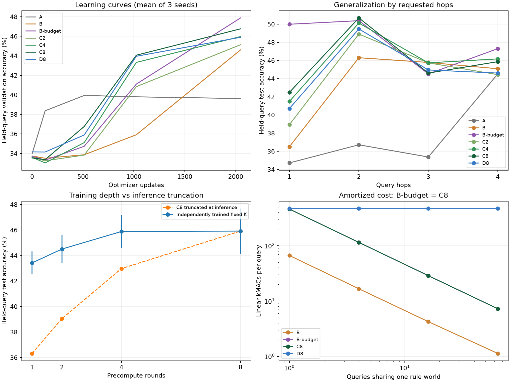

# WSR：冻结模型的状态重组与可复用预计算

[English](README.md) · [完整架构](docs/WSR_ARCHITECTURE.md) · [复现说明](docs/REPRODUCIBILITY.md) · [研究总结](docs/RESEARCH_OVERVIEW.md)

**额外的共享参数循环计算，能否形成有用的中间结果，并在不知道具体查询时提前计算、随后重复利用？**

这是一个围绕上述问题逐步开展的独立 PyTorch 研究项目。从冻结官方 Mamba2-130M 的内部状态改写出发，通过信息读取诊断、最终答案监督的循环沙盒，以及参数量/计算量匹配对照，区分“信息存在”“读取器会用”“多轮计算有效”和“复用成本降低”。

## 主要工作

- **可微状态接口：** 截取、修改、注入 SSM 状态，保留卷积缓存与其他层；验证分段续算、下一 token 对齐，以及损失穿过冻结主模型回传到编辑器。
- **瓶颈诊断：** 事实探针、特权输入、MLP/循环查询对照与中间状态干预；区分基础事实可读性和组合计算能力。
- **层位敏感性：** 第6/13/20层、不同历史与预测窗口，共72个离线梯度案例；不把利用真实未来的梯度降损算作推理收益。
- **预计算训练与公平对照：** 同一规则只运行一次无查询预计算，再由统一轻量头回答多个查询；控制参数、最终答案数量和线性运算量。

## 最新结果

随机6节点规则、三色平衡、1–4跳；7配置×3配对种子，每个2048次更新。全部为未见测试规则的三种子平均准确率：

| 模型 | 训练查询组合 | 留出查询组合 |
|---|---:|---:|
| A：无预计算 | 37.61% | 37.84% |
| B＝C1：单次预计算 | 61.57% | 43.42% |
| B-budget：宽单次前馈 | 63.52% | **48.06%** |
| C2：共享两轮 | 62.70% | 44.51% |
| C4：共享四轮 | 63.59% | 45.89% |
| C8：共享八轮 | **64.43%** | 45.92% |
| D8：查询已知的八轮计算 | 63.45% | 44.94% |

**预计算有价值，但尚未证明多轮预计算具有独特泛化收益。** C8优于同参数量B，却在留出组合上三个种子均低于线性计算量匹配的B-budget。后者参数更多，实测推理更快；C具有参数复用的折中价值。多查询摊销也适用于B，不能归因于循环独有的能力。



完整均值/SD、逐种子原始表与成本见[报告](results/wsr-v0.3-precompute/REPORT.md)及[研究判断](results/wsr-v0.3-precompute/FINDINGS.md)。

## 快速运行

```bash
python -m venv .venv
source .venv/bin/activate
python -m pip install torch==2.6.0 --index-url https://download.pytorch.org/whl/cpu
python -m pip install -e '.[analysis,pretrained,v02]'
python -m unittest discover -s tests -v
python scripts/verify_published_results.py
python -m wsr.demo --model C8 --steps 512
```

演示是32条固定样本的训练链路检查，**不等同于泛化结果**；不下载模型或语料。Windows使用`.venv\Scripts\activate`激活环境。

完整静态规则对照：`python -m wsr.reproduce_precompute --stage full`。输出写入忽略的`artifacts/`，不会覆盖提交的`results/`。模型与真实语料实验需要另行准备资产，见[复现分层说明](docs/REPRODUCIBILITY.md)。

## 研究贡献与边界

研究问题、对照约束与迭代决策由倪金海设计推进；实现、实验执行和文档使用了AI编码工具辅助。项目展示可微推理工程、实验设计、瓶颈诊断以及对负结果的分析能力。

目前没有稳定提升真实语言预测的结论，没有实现自主停止/自主寻址；两个独立工作区沙盒均未接入Mamba。v0.2b的100%属于特权正确事实和明确控制结构下的小型规则任务；32K是连续评价长度，不能写成32K梯度训练。

采用Apache-2.0许可证；保留官方Mamba参考代码署名。不分发预训练权重、语料正文、运行缓存或本机私有配置。历史实验中的正、负结果和预试验均在[研究索引](docs/RESEARCH_OVERVIEW.md)中注明公开范围。
