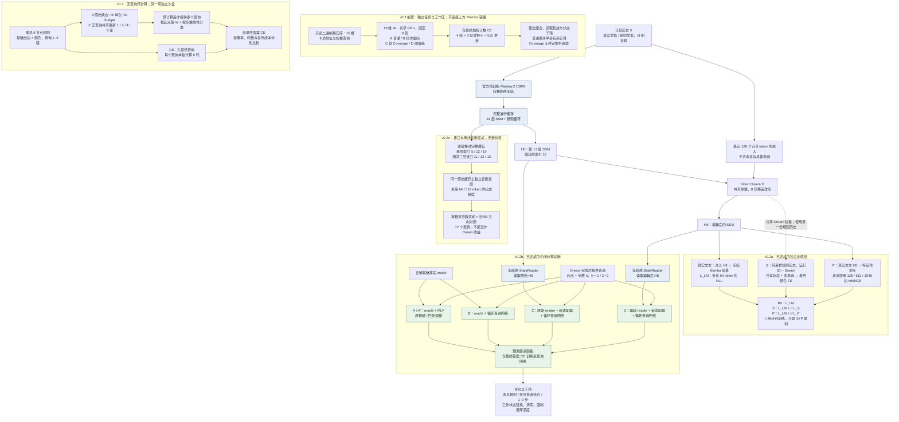
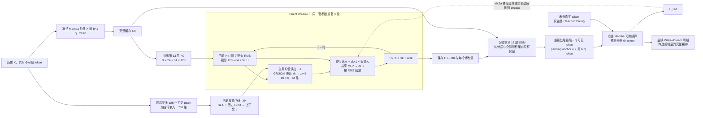
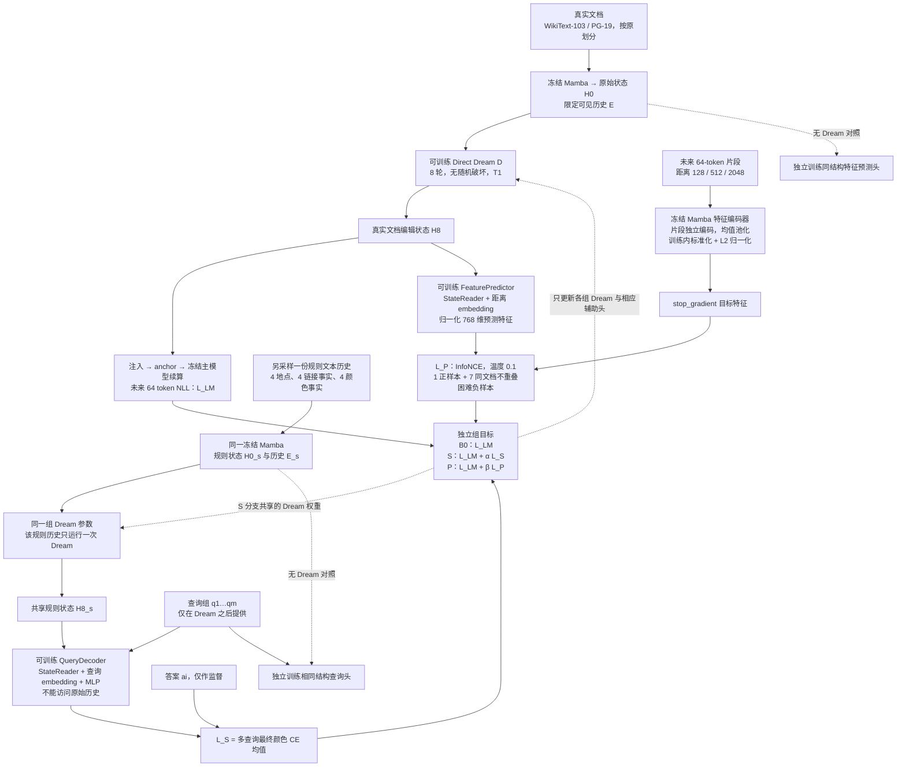
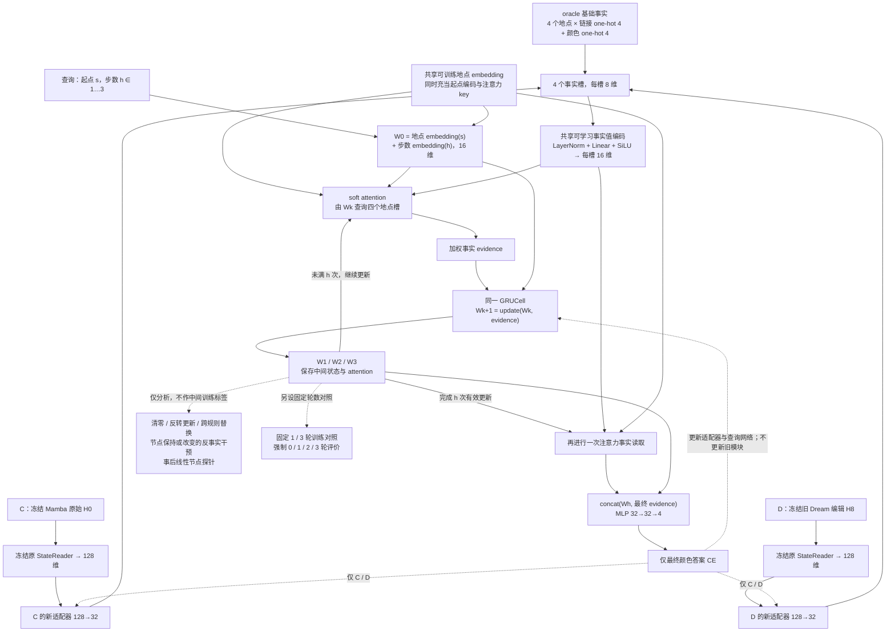
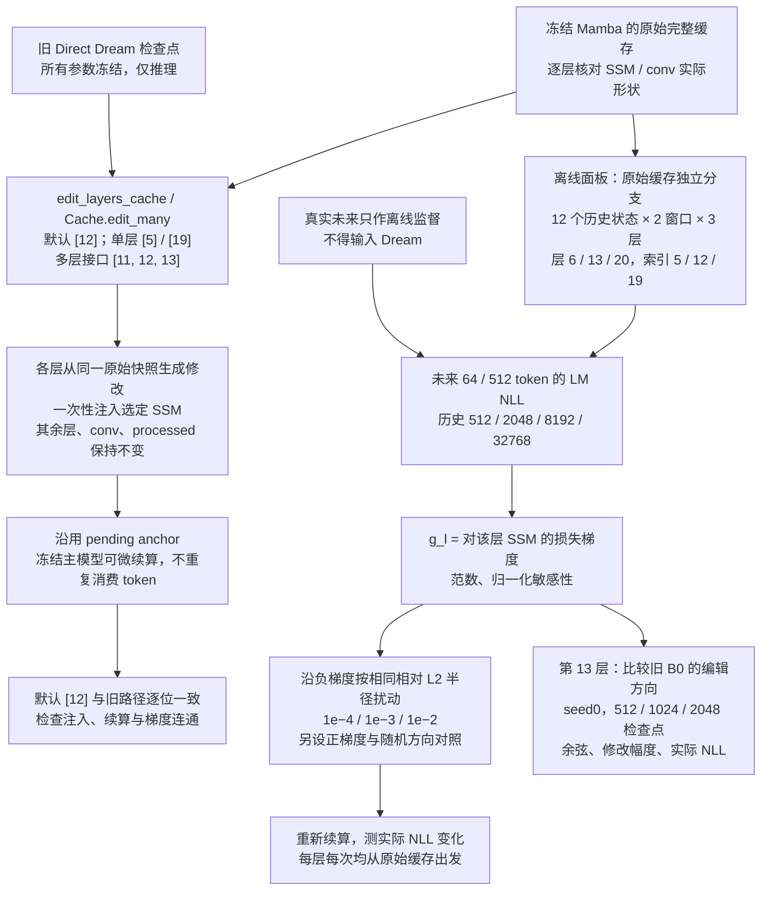
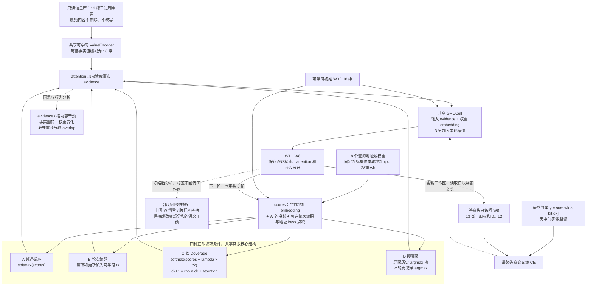
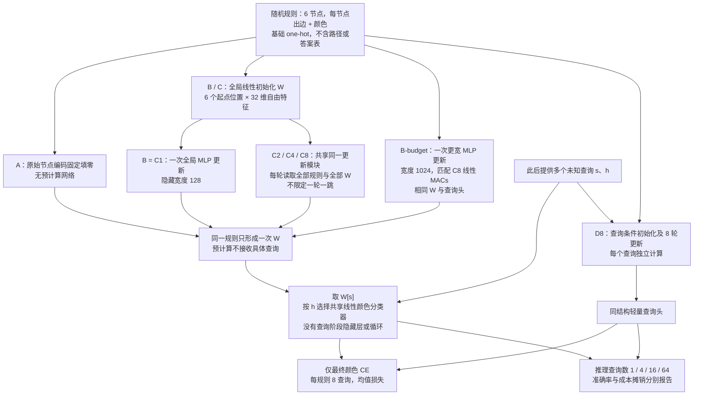

> Historical research record. This public export includes selected reports, numerical tables and figures; original checkpoints/caches are not distributed. Paths below describe the original experiment unless linked to a public file.

# WSR 当前完整实验架构

截至 2026-11-18，覆盖 v0.2a、v0.2b、v0.2c、v0.3 前置实验与 v0.3 无查询预计算沙盒。以下均为 Mermaid 文本图；各版本是不同阶段的实验视图，不是同时联合训练的一个大模型。

**最新边界：v0.2c 仅完成接口与离线梯度诊断；v0.3 前置及无查询预计算沙盒均完成三种子对照，均未接入 Mamba。** 软 Coverage 无稳定收益；新的 C8 优于同参数量单次 B，但未在留出组合上超过计算量匹配的 B-budget，不据此启动 Mamba 工作区训练。

## 1. 实验总览

图例：蓝色为冻结基底或原读取器，绿色为 v0.2b 新训练的查询模块与其监督。Direct Dream 在 v0.2a 可训练，在 v0.2b/v0.2c 完全冻结。v0.2b、v0.3 前置与 v0.3 无查询预计算各有独立的 A/B/C/D 编号，也不同于 v0.1 的 Dream 架构 A/D。

## 2. Direct Dream 与可微状态续算（原始第 13 层路径）

- 主模型为 `state-spaces/mamba2-130m`：24 层、模型宽度 768，128,989,632 个冻结参数。运行路径为载入官方权重的 FP32 可微 PyTorch 实现，不能等同于已启用官方融合 CUDA kernel。
- 编辑层的状态形状为 `[batch, 24 heads, 64 head_dim, 128 state_dim]`。8 轮共享编辑参数，历史编码 GRU 与编辑循环 GRU 是不同模块。
- 每个 Dream 调用都重置内部 `z`；可跨周期积累的是 Mamba 缓存。此 Direct Dream 分支未接入独立工作区或新增持久记忆槽；v0.3 前置的 W 是另一项独立实验。
- 缓存只处理到可见历史的倒数第二个 token。注入后重跑最后一个可见 token，才得到编辑后的首个未来预测，避免使用编辑前已算好的 logits。
- 未来文本不进入 Dream；续算时的 teacher forcing 不等于向 Dream 泄漏答案。主模型参数冻结，续算对注入状态的梯度仍保留。
- v0.2a 每更新包含两个连续周期，各监督 64 token；周期之间保留缓存数值、截断梯度。因此每更新监督 128 个 LM token，但单次反传范围仍为 64 token，不能称为长程梯度优化。不同文档或书籍之间重置状态。
- 上图保留旧检查点对应的 `[12]` 路径；v0.2c 将编辑层改为可配置，默认路径与旧路径逐位一致，详见第 5 节。

## 3. v0.2a：B0 / S / P 的实际训练信号

S 与真实文本 LM 使用不同历史、不同状态，只共享主模型和 Dream 参数；P 使用真实文本对应的编辑状态。辅助头无 Dream 基线单独训练，用于区分头本身学会任务与状态编辑的贡献。α、β 按训练内初始梯度量级校准，不是默认等权。S+P 未启动。

StateReader 对每个头的 SSM 做 RMS 归一化，逐行投影 `128→16`，沿 head_dim 取均值，拼接逐头 log-RMS，最终 `408→128`。原 S 查询 MLP 再拼接起点及步数 embedding；它没有访问全部历史的旁路。

## 4. v0.2b：最终答案监督下的循环查询计算

图中 oracle、C、D 是互斥输入条件；三条输入不会相加或拼接。C/D 适配器输出虽按四槽排列，但没有基础事实标签监督，不预设其已经学会可解释事实。

| 条件 | 输入 | 本轮训练参数 | 参数量 |
|---|---|---|---:|
| A | oracle 事实填零至 128 维 | 原查询 MLP（含查询嵌入） | 9,596，含 6,144 个零填充对应的无效权重 |
| A′ | oracle 32 维事实 | 匹配规模 MLP（含查询嵌入） | 3,081 |
| B | oracle 四槽事实 | 事实编码、注意力键、共享 GRU、答案头 | 3,092 |
| C | 原始 H0 的冻结 reader 特征 | 新适配器 + 与 B 同结构查询核心 | 7,220 |
| D | 编辑 H8 的冻结 reader 特征 | 新适配器 + 与 B 同结构查询核心 | 7,220 |

每组独立训练；C/D 同种子从匹配初始化开始，不加载已经学好的 oracle 核心。三种子共享训练日程，每组主实验 8,192 次更新，每更新 16 规则 × 8 查询。使用原 1,024 训练规则、256 验证规则，8 种训练查询组合、4 种留出组合；另有 112 条未见四色四环规则只作诊断。

本轮 Mamba、旧 Dream 与原 StateReader 全冻结。C/D 均使用同一份旧 S-seed0、2048 更新的 Dream/reader 检查点；三个种子是新查询网络种子，不是三个 Dream 种子。

另有独立的特权诊断：`冻结 reader → 额外事实标签监督的线性桥 → 冻结已训练 oracle 查询核心`。它不属于 C/D 最终答案监督主链路，不能算作 Dream 的新能力。

结构中人为规定了地点分槽、共享地址 embedding 和 `h 步查询 → h 次有效更新`。网络学习的是软读取、状态转移与答案映射；没有硬编码符号链接执行，也没有中间节点损失。与 MLP 的对照同时改变了槽共享、注意力和循环结构，未匹配 FLOPs，不能将全部差异只归因于循环。

## 5. v0.2c：可配置状态层位与离线梯度诊断

实际检查后，官方 130M 的 24 层 SSM 均为 `[B,24,64,128]`，卷积缓存均为 `[B,1792,4]`。新接口仍逐层校验，不把这一结果硬编码为所有模型的假设；支持共享编辑器及匹配形状的逐层编辑器映射。相邻三层注入与梯度接口已经验证，**不代表三层联合训练或协调收益已经验证**。

诊断使用两本 PG-19 验证书的四种历史长度，以及两篇 WikiText 验证文章的 512/2048 历史，共 72 个案例。512-token 反传采用 64-token 块的激活重计算，跨块计算图不 detach，不能与 v0.2a 的 64-token 截断反传混淆。

结果：相对修改半径 `1e−4` 时，三层各 24/24 案例均能沿负梯度降损；更大半径下第 20 层更易退化。没有证据表明第 13 层明显不适合改写；旧 B0 后期的长历史退化仍在。上述梯度使用真实未来，只说明局部可改进空间，不能算作无未来输入的 Dream 推理收益。

**本阶段 Mamba 与 Dream 均为 0 次优化器更新。** L6/L20 的新训练、2048 步三种子扩展，以及相邻三层共享/独立编辑器与范数控制实验均尚未运行。

## 6. v0.3 前置：独立多轮工作区与不对称读取

这一分支未加载 Mamba、Direct Dream 或 StateReader。下图的信息库不是 Mamba SSM；工作区 W 不回写语言模型缓存。

两类任务各占一半：**连续新读**访问 8 个不同槽；**返回重读**按 `a,b,c,d,a,e,f,g` 访问，第一项在第五轮再次使用。权重为四个 1、四个 2。模型可能把旧事实缓存在 W 中，因此任务要求再次利用旧信息，不证明必须物理重读。查询游标与地址由实现提供，网络学习软读取、状态更新和答案映射；未硬编码加权累加，也未要求模型自主发现下一地址。

| 组别 | 额外机制状态 / 参数 | 留出查询组合准确率，三种子均值 ± SD |
|---|---|---:|
| A：普通循环 | 无；2,733 参数 | 89.81 ± 2.99% |
| B：轮次编码 | 8×16 可学习轮次参数；总计 2,861 参数 | 89.04 ± 1.33% |
| C：软 Coverage | 16 维累计 attention；2,733 参数 | 89.55 ± 2.16% |
| D：硬屏蔽 | 16 位已读掩码；2,733 参数 | 64.17 ± 1.46% |

C 使用 `lambda=1、rho=0.9`，Coverage 不 detach，允许重读；D 只屏蔽每轮 attention 的 argmax 槽。四组均为 16 维 W、共享 GRU、固定 8 轮、仅最终答案 CE，没有 S/P 辅助损失。A/B/C/D 公共参数和样本日程按种子配对。

正式预算为每组 **3 个配对种子 × 512 次 Adam 更新，batch=64**，CPU FP32 单线程。训练集 8,008 个事实库；验证/测试各含同查询池新实例与留出组合两个面板，每面板 520 条。事实库跨面板去重，完整查询按哈希划分；13 类严格等频，随机及多数类基线均为 7.69%。同查询池不等于具体查询已在训练中出现。32 条样本过拟合检查达到 100%，不计入主实验预算；预试验失败任务与四轮计数正对照均独立归档，不作为机制收益证据。

主要结论与边界：

- 普通 A 形成了有用的中间状态：第 4 轮 evidence 清零后准确率降至 42.44%；改变部分和的 W 替换后，按捐赠部分和计算的新答案准确率约 72.24%。结合事实反事实与事后探针，支持中间计数信息参与后续计算，但不能声称 W 是完全解耦的符号计数器。
- C 改变了软 attention 分配，未稳定改善任务效果；C−A 配对平均差为 −0.26 个百分点。D 尤其损害重读任务，不能把读取多样性本身视为成功。B 也无稳定改善。
- 推理轮数扫描为 1/2/4/6/8/10/12，训练始终 8 轮。少轮省略查询、多轮重复最后地址与权重，目标仍是原 8 项答案；这不是等价计算预算对照，不能据此声称学会自主停止。
- 当前暂不接入 Mamba，不启动大规模 v0.3，也未叠加随机轮数训练或辅助监督退火。

## 7. v0.3：无查询预计算与极轻量查询读取

规则/颜色均随机生成；三色平衡、跨划分出边图不重复；24 个起点×步数组合中 16 个用于训练、8 个留出。A/B/C/B-budget 的查询读取预算完全相同，接口能表达正确答案。工作区按起点索引是结构先验，但各维不接受事实对齐或中间结果监督。没有 Coverage、轮次编码、Anytime 或随机轮数训练。

7 个配置 × 3 配对种子，各 2048 更新；C1 与 B 精确等价并复用结果。新规则的训练/留出组合准确率均值：B 为 61.57%/43.42%，B-budget 为 63.52%/48.06%，C8 为 64.43%/45.92%，D8 为 63.45%/44.94%。C8 优于同参数量 B，但对计算量匹配 B-budget，训练组合略高、留出组合三个种子均更低；尚不支持多轮预计算的独特优势。

无查询预计算可以复用于多个查询，降低平均成本；B 和 B-budget 也具备这项收益。固定训练轮数由实现指定，不能称自主停止；本轮无自主寻址或逐轮分工的因果结论，不接入 Mamba。

## 8. 对照、干预与版本边界

| 范围 | 已有对照 / 分析 | 主要区分 |
|---|---|---|
| v0.1 归档 | Dream A/D × T1/T2 × 有无破坏，共 8 组；无 Dream、破坏不修复 | 循环记忆、去噪预训练、随机干预 |
| v0.2a | B0/S/P、独立无 Dream 辅助头、1/2/4/8 轮、不同未来距离、周期性 Wake–Dream | 主 LM 收益、辅助头收益、多轮与连续运行 |
| v0.2a 三项诊断 | 修改幅度 `H0+s(H8−H0)`；S 三级信息读取；P 特征可预测性与困难负样本 | 过度改写、信息与读取瓶颈、主题捷径 |
| v0.2b | oracle 与原始/编辑 reader；MLP 与循环；固定轮数；工作状态因果干预 | 查询优化、组合泛化、信息读取和有用中间状态 |
| v0.2c | 可配置单层/多层接口；层 6/13/20 的等范数梯度扰动；旧 B0 方向对齐 | 层位敏感性与局部可改进空间；未训练新层位或多层 Dream |
| v0.3 前置 | 独立任务 A/B/C/D；三配对种子；读取、事实及中间状态干预 | 普通循环的有用计算与 Coverage 的额外贡献；未接入 Mamba |
| v0.3 无查询预计算 | A/B/B-budget/C1–8/D8；统一轻量查询头、答案数量；复用成本 | 预计算收益、参数与计算量、多轮的额外价值；未接入 Mamba |

短中程真实文本训练与 8K/32K 长程评价分开记录；128K 是后续探索项。各版本保留训练/验证边界，最终测试集不用于调参；v0.2c 仅使用验证语料，v0.3 前置的任务测试在主配置全部训练完成后评价。v0.2b 之后没有新的基础模型或 Direct Dream 训练，也没有把独立工作区接入 Mamba。

四种循环必须分开理解：**Direct Dream 的 8 轮改写 Mamba SSM；v0.2b 查询网络在查询到来后组合事实；v0.3 前置按已给地址逐轮操作二进制库；v0.3 的 C 在查询到来前预计算随机规则。** 后三者的 W 都不回写 Mamba，两个 v0.3 沙盒均未从 Mamba 状态读取信息。

## 9. 代码与报告依据

- [Direct Dream、历史窗口与缓存编辑](../wsr/state_dream.py)
- [冻结预训练主模型与状态续算](../wsr/pretrained_model.py)
- [v0.2a 训练目标与分支](../wsr/v02_train.py)
- [v0.2a 实验协议](WSR_V02A.md)
- [v0.2b 查询网络、事实适配器与训练](../wsr/v02b_query.py)
- [v0.2b 中间状态分析](../wsr/v02b_analyze.py)
- [v0.2b 完整报告与结果](../results/wsr-v0.2b/REPORT.md)
- [v0.2b 冻结范围与复现说明](WSR_V02B.md)
- [v0.2c 可配置编辑层与缓存检查](../wsr/layer_edit.py)
- [v0.2c 层位梯度诊断与分块反传](../wsr/v02c_diagnostics.py)
- [v0.2c 协议、接口与阶段边界](WSR_V02C.md)
- [v0.2c 诊断结论](../results/wsr-v0.2c/FINDINGS.md)
- [v0.2c 完整报告](../results/wsr-v0.2c/REPORT.md)
- [v0.3 前置工作区与四种读取机制](../wsr/workspace_model.py)
- [v0.3 前置任务与数据划分](../wsr/workspace_tasks.py)
- [v0.3 前置训练、干预与分析](../wsr/workspace_experiment.py)
- [v0.3 前置协议与预试验归档](WSR_V03_PRE.md)
- [v0.3 前置结论与决策](../results/wsr-v0.3-pre/FINDINGS.md)
- [v0.3 前置完整报告](../results/wsr-v0.3-pre/REPORT.md)
- [v0.3 无查询预计算模型与轻量读取头](../wsr/precompute_model.py)
- [v0.3 随机规则、答案生成与划分](../wsr/precompute_tasks.py)
- [v0.3 训练、成本与评价](../wsr/precompute_experiment.py)
- [v0.3 协议与复现](WSR_V03.md)
- [v0.3 无查询预计算结论](../results/wsr-v0.3-precompute/FINDINGS.md)
- [v0.3 无查询预计算完整报告](../results/wsr-v0.3-precompute/REPORT.md)
