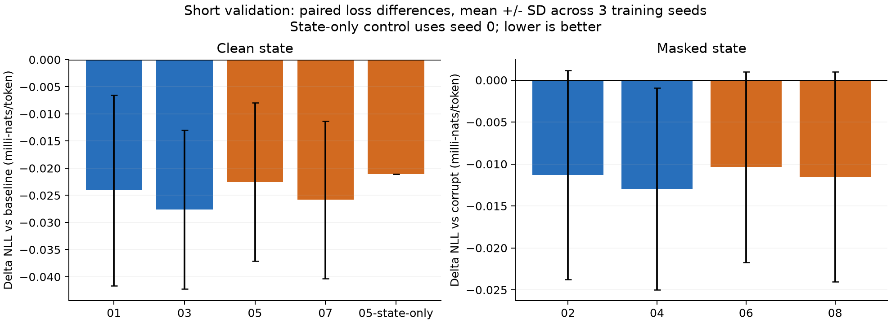
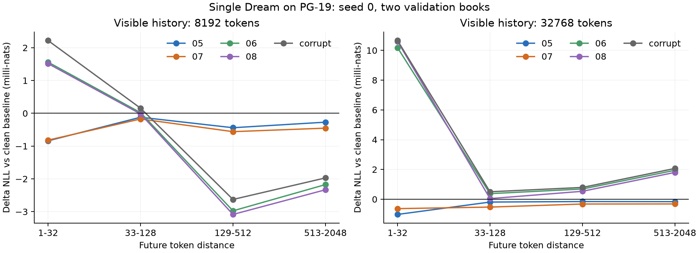
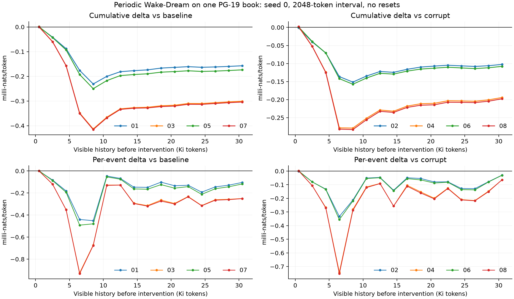
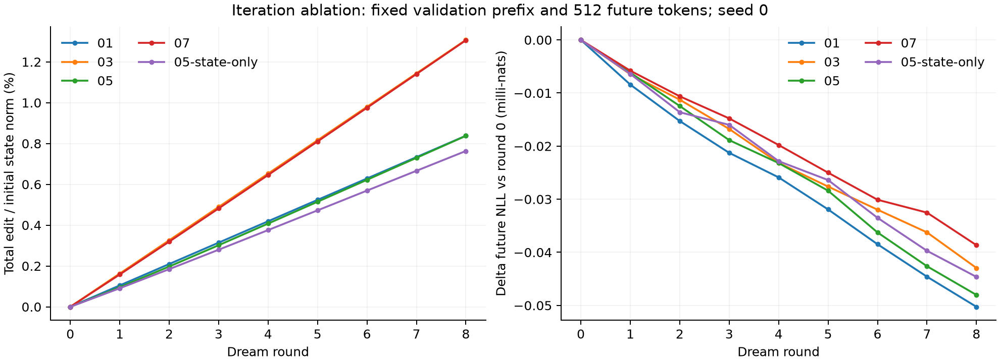

> Historical research record. This public export includes selected reports, numerical tables and figures; original checkpoints/caches are not distributed. Paths below describe the original experiment unless linked to a public file.

WSR-v0.1：官方预训练 Mamba2-130M 状态重组实验

本轮已改为冻结官方预训练权重的真实文本实验。结果为低预算探索性验证，不预设改写必须提升计数、检索或规则能力。旧合成与时间尺度实验及其归档没有被覆盖。

基底：state-spaces/mamba2-130m，revision `3a5aea0c25d0fb43cc360e2c2aac82c26e3eed49`，严格匹配全部权重键与维度，128,989,632 个参数冻结。FP32 可微 PyTorch 后端保留完整预训练架构，原生 Mamba CUDA kernels 未参与实验；与固定官方 v2.2.5 Python step/SSD 定义独立比较。

接口验收：连续/分段 logit 最大绝对差 0.000518799；与官方完整逐 token 路径最大差 0.000411987；注入状态的真实语言预测梯度范数 0.0232729。清零或遮蔽状态会改变后续预测，所有原参数无梯度。另有 14 项单元测试及独立双精度 SSD gradcheck。8K 前缀用 128/256-token 两种 wake 分段时，后续 512-token 平均绝对 NLL 差约 7.77e-6；同一缓存的零改写逐 token NLL 差为零，配对评价各组使用相同分段与干净历史缓存。

改写层为索引 12（第 13 层）的完整 SSM `[1,24,64,128]`。所有卷积缓存与其他层状态在干预瞬间保留。边界 b 的历史可见长度为 b，缓存累计处理 b−1；最后一个可见 token 留作 anchor，在编辑后处理，重新产生第一个未来 token 的 logit。所有比较使用同一约定，后续连续运行不重复 anchor，也不使用旧 logits。

8 组各三个种子，共 24 个主训练；另有 seed=0 的仅输入状态 D/T1/无破坏对照。共享编辑器沿状态行工作，Dream 共 137,664 个参数，hidden=64，八轮；D 的 GRU 记忆在一次 Dream 的八轮间传递、下次 Dream 重新初始化。A 不传递独立循环隐状态。比较的是这两个实现，未声称严格匹配有效参数/计算量或完全隔离所有额外状态聚合操作。

每组 32 次未来预测更新，T2 额外八次去噪并沿用同一 Adam 状态，不属于等计算预算对照；未来预测阶段的文档、边界与随机破坏种子与 T1 对齐。batch=1，每更新两个连续周期，干预间隔 256，lr=3e-4、梯度裁剪 1。只对未来 64 token 反传，周期间保留缓存值并截断梯度。长历史 8K/32K 是评价，不是长距离梯度优化。没有按短程收益筛掉任何一组。

训练文档池为原划分的 12 个 WikiText-103 文档和 4 本 PG-19 书，实际采样文档与片段逐项写入 training.json。验证文章按长度筛选两个完整且不少于 4096 token 的文档，未按损失选取；PG-19 长程单次评价用两本 40K 自然前缀，周期性评价用其中一本至 32K。文章/书之间重置，同一书内部周期性传递缓存。原测试集保持封存，以下均是验证结果；不能称作最终测试成绩。

短中程结果使用两个 WikiText 验证文档，在 512、2048 个可见历史 token 后预测 2048 个 token。损失为 tokenizer 级自然对数 NLL，未换算成 PG-19 官方 word-level PPL。均值 ± 标准差只描述三个训练种子，不是置信区间；无 Dream 与仅状态对照只使用 seed=0。评价破坏掩码按文档和边界固定，各训练种子共享；尚未进行多个评价掩码的重复检验。Δ 为配对损失，负数更好；“同状态对照”对无破坏组用原基线、对破坏组用破坏后不修复。

| 配置 | 架构 / 训练 / 破坏 | NLL | 相对无 Dream Δ（milli-nats/token） | 相对同状态对照 Δ（milli-nats/token） |
| --- | --- | --- | --- | --- |
| baseline | 无 Dream / 无破坏 | 3.148165 | 0.000 | 0.000 |
| corrupt | 无 Dream / 10% 遮蔽 | 3.148521 | 0.356 | 0.000 |
| 01 | A / T1 / 无破坏 | 3.148141 ± 0.000018 | -0.024 ± 0.018 | -0.024 |
| 02 | A / T1 / 10% 遮蔽 | 3.148510 ± 0.000012 | 0.345 ± 0.012 | -0.011 |
| 03 | A / T2 / 无破坏 | 3.148138 ± 0.000015 | -0.028 ± 0.015 | -0.028 |
| 04 | A / T2 / 10% 遮蔽 | 3.148509 ± 0.000012 | 0.343 ± 0.012 | -0.013 |
| 05 | D / T1 / 无破坏 | 3.148143 ± 0.000015 | -0.023 ± 0.015 | -0.023 |
| 06 | D / T1 / 10% 遮蔽 | 3.148511 ± 0.000011 | 0.346 ± 0.011 | -0.010 |
| 07 | D / T2 / 无破坏 | 3.148140 ± 0.000014 | -0.026 ± 0.014 | -0.026 |
| 08 | D / T2 / 10% 遮蔽 | 3.148510 ± 0.000012 | 0.345 ± 0.012 | -0.012 |
| 05-state-only | D / T1 / 无破坏 / 仅状态 | 3.148144 | -0.021 | -0.021 |

单次 Dream 的长历史结果（seed=0，两本 PG-19 书，均预测后续 2048 token）。周期性一列来自其中一本书的整个 32K 流，文本与计分区间不同，不应与单次列直接相减；应在各自列内与同位置基线比较：

| 配置 | 8K 历史 NLL | 32K 历史 NLL | 周期性至 32K NLL |
| --- | --- | --- | --- |
| baseline | 3.315394 | 3.006656 | 3.153893 |
| corrupt | 3.313465 | 3.008545 | 3.145929 |
| 01 | 3.315116 | 3.006497 | 3.153736 |
| 02 | 3.313243 | 3.008429 | 3.145827 |
| 03 | 3.314933 | 3.006323 | 3.153592 |
| 04 | 3.313094 | 3.008275 | 3.145735 |
| 05 | 3.315090 | 3.006480 | 3.153719 |
| 06 | 3.313231 | 3.008419 | 3.145821 |
| 07 | 3.314929 | 3.006323 | 3.153589 |
| 08 | 3.313089 | 3.008273 | 3.145731 |
| 05-state-only | 3.315081 | 3.006471 | 3.153708 |

周期性结果保持同一书籍状态，首次在 512 可见 token 干预，其后每 2048 token 干预，直到 32K，没有在周期间重置。以下均相对无 Dream 的同位置预测，正数表示退化。本表单位为 milli-nats/token（千分之一 nat）。首/末四个周期采用 token 加权；8K/32K 是从首次干预起至该全局长度的累计配对损失。只测一个验证书、一个训练种子，不能据此概括所有书籍上的积累规律。

| 配置 | 前四周期 Δ | 后四周期 Δ | 累计至 8K Δ | 累计至 32K Δ |
| --- | --- | --- | --- | --- |
| baseline | 0.000 | 0.000 | 0.000 | 0.000 |
| corrupt | -1.201 | -8.787 | -1.294 | -7.964 |
| 01 | -0.176 | -0.145 | -0.176 | -0.157 |
| 02 | -1.338 | -8.882 | -1.430 | -8.066 |
| 03 | -0.349 | -0.272 | -0.349 | -0.301 |
| 04 | -1.480 | -8.952 | -1.572 | -8.158 |
| 05 | -0.193 | -0.162 | -0.193 | -0.174 |
| 06 | -1.343 | -8.887 | -1.436 | -8.072 |
| 07 | -0.351 | -0.275 | -0.350 | -0.304 |
| 08 | -1.483 | -8.954 | -1.575 | -8.161 |
| 05-state-only | -0.204 | -0.174 | -0.204 | -0.185 |

固定验证前缀的轮次扫描（同一个训练八轮的模型，seed=0，后续 512 tokens）：

| 配置 | 八轮后相对状态修改幅度 | Round 8 − Round 0 的 NLL（milli-nats） |
| --- | --- | --- |
| 01 | 0.8382% | -0.050 |
| 02 | 0.8109% | -0.038 |
| 03 | 1.3076% | -0.043 |
| 04 | 1.2300% | -0.032 |
| 05 | 0.8376% | -0.048 |
| 06 | 0.7938% | -0.037 |
| 07 | 1.3059% | -0.039 |
| 08 | 1.2241% | -0.029 |
| 05-state-only | 0.7634% | -0.045 |

曲线与逐 token CSV 用于检查短期退化/长期改善，以及多轮修改是否趋稳；不以单个最短 horizon 选择配置。轮次扫描并非独立训练的单次编辑器，不能单凭扫描排除普通状态适配的解释。历史仅状态对照在 Dream 时也不读取 pending anchor，该信息差异在 history_window 与 state_history 中明确记录。

所有原始逐 token 损失、训练数据身份、每轮/每 head 修改范数、第一/最后训练样本及代表性评价的完整状态轨迹均保留。轨迹中相对编辑量以 Dream 输入状态为分母；破坏后的改写量与破坏本身的改变量分开记录。长程仅 seed=0，验证文本较少，当前优化预算很小，效果大小与种子差异均需结合原始数据解释。

产物：`short-summary.csv`、`future-distance.csv`、`periodic-events.csv`、`rounds.csv`；主模型/分词器校验见 `model/manifest.json`，原文档划分与哈希见 `data/manifest.json`，权重与优化器检查点见 `formal/`，接口检查见 `interface-verification.json`。旧实验归档为 `artifacts/legacy-2026-11-13/`。

本轮观察与边界

1. 可训练性已得到支持：未来语言预测损失能穿过冻结主模型回传，Dream 参数和真实 SSM 状态发生变化，原模型权重保持不变。它不等同于已证明复杂状态重组或整体语言能力提升。
2. WikiText 短中程中，无破坏各组平均只改善约 2–3×10⁻⁵ NLL；D 没有稳定胜过 A，T2 与 T1 的差异也小于当前种子波动。仅状态对照在 seed=0 与含 128-token 历史的 D 接近，目前不能据此认定历史没有价值。
3. 长历史下出现了距离相关的符号变化。8K 历史的两本 PG-19 书上，仅破坏的前 1–32 token 平均退化 +0.002219 NLL，而后续 513–2048 token 平均改善 −0.001971；D/T1/破坏对应为 +0.001560 与 −0.002175。32K 历史下同样的破坏方案并没有复现这一净收益。位置、文本和破坏样本同时不同，不能把变化只归因于历史长度。
4. 连续 32K 的单本书中，无破坏 D/T1 的平均 ΔNLL 为 −0.000174，D/T2 为 −0.000304。其累计收益未持续放大，经过早期变化后变得较平缓；没有在该轨迹观察到持续扩大的改善，也未出现后段整体退化。这个描述只适用于该书、该种子和当前 2048-token 周期，不是状态动力系统收敛的证明。
5. 随机破坏本身是重要混杂来源：周期性“仅破坏”已改善 −0.007964 NLL；D/T1/破坏总改善为 −0.008072，Dream 在破坏对照之上的增量仅约 −0.000108。不能把前者的大部分收益记作 Dream 学会重组的证据。相同机制在 WikiText 短程反而整体有害。
6. 固定前缀的八轮改写约为初始状态范数的 0.76%–1.31%，累积幅度近线性增加，没有显示状态已经收敛。A 的首末单轮方向几乎相同，D/T1 的方向余弦约 0.996，A/D 最终总改写方向余弦约 0.995。当前探针更接近连续小幅、近共线改写；D 的循环状态确实参与优化，但还没有出现清楚的独特优势。

总更新预算仍很小，每组仅 4096 个未来 token 的梯度监督，T2 另有八次状态去噪更新且延续 Adam 状态。未做等计算量、严格参数量匹配和独立训练的单次编辑器对照。测试集未参与调参或本轮评价；128K 尚未运行。这些结果应作为闭环与现象的第一轮记录，不能推广为模型或机制的普遍优劣。

