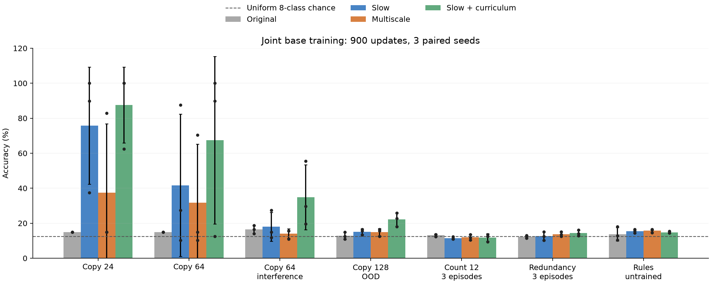
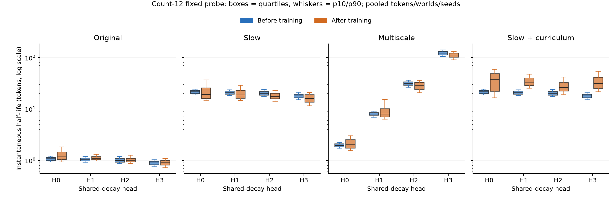

> Historical research record. This public export includes selected reports, numerical tables and figures; original checkpoints/caches are not distributed. Paths below describe the original experiment unless linked to a public file.

时间尺度与基础能力：受控实验

本轮只训练基础 SSM；没有训练 Dream。递推方程、参数数量和任务 token 接口保持一致，原实验结果已保留。

四组、3 个配对种子，共 12 次运行；每次 900 个 Adam 更新，lr=0.002，每批 16 个独立世界，梯度裁剪 1。复制、计数、冗余表示按固定顺序轮换，使用相同训练世界 seed。测试每项 128 个世界，原任务每世界三轮连续状态；不同世界重置。训练和测试 seed 不重叠。测试不参与初始化校准。

原始组 log_a=0；慢衰减组及课程组 log_a=-3；多尺度组以训练侧固定输入的 mean(dt) 校准四个 head，目标有效半衰期约 2、8、32、128 token。参数 log_a 仍可训练。每个 head 内的 8 个通道 × 8 个状态坐标共享衰减，因此这是四组时间尺度，并非 256 个独立时间常数。其他初始参数的哈希在同一 seed 下完全一致。

课程组前 1/4 更新使用短复制、两步计数、单对映射；第二个 1/4 使用中等复制、四步三轮计数、两对映射；后 1/2 使用与其他组相同的挑战任务。每阶段仍轮换三个任务，减轻整段切换任务造成的遗忘。非课程组始终使用挑战训练，复制长度为 2、8、24、64，均包含中性填充和随机别名干扰。课程只匹配总更新数，没有匹配 token 数、答案数和困难任务曝光次数，实际预算另存 JSON。

以下为三个种子的测试正确率均值 ± 样本标准差（百分点）；同一行来自同一批测试世界，表内所有任务由同一个共享模型完成。多数类基线、逐世界预测和分轮正确率均保存在每次运行的 result.json。复制 128 是长度外推，规则链未训练，二者作为挑战测试。

| 测试 | 原始衰减 | 慢衰减 | 多时间尺度 | 慢衰减＋课程 |
| --- | --- | --- | --- | --- |
| 复制 8 | 14.8 ± 0.0 | 83.3 ± 20.7 | 47.4 ± 46.0 | 94.3 ± 9.9 |
| 复制 24 | 14.8 ± 0.0 | 75.8 ± 33.5 | 37.5 ± 39.2 | 87.5 ± 21.7 |
| 复制 64 | 14.8 ± 0.0 | 41.7 ± 40.6 | 31.8 ± 33.5 | 67.4 ± 47.9 |
| 复制 64＋干扰 | 16.4 ± 2.3 | 18.0 ± 8.3 | 14.1 ± 2.7 | 34.9 ± 18.5 |
| 复制 128＋干扰（未训练长度） | 12.8 ± 2.0 | 15.1 ± 1.6 | 14.8 ± 2.1 | 22.1 ± 3.9 |
| 两步计数 | 7.0 ± 0.0 | 11.2 ± 3.6 | 10.9 ± 7.5 | 30.5 ± 4.9 |
| 四步计数 | 13.0 ± 1.8 | 13.0 ± 1.2 | 10.7 ± 4.0 | 8.3 ± 3.2 |
| 原十二步计数，连续三轮 | 13.1 ± 0.8 | 11.5 ± 0.7 | 11.9 ± 1.6 | 11.8 ± 2.2 |
| 两对映射检索 | 13.0 ± 3.0 | 21.1 ± 4.3 | 19.0 ± 5.0 | 33.1 ± 4.3 |
| 原冗余表示，连续三轮 | 12.2 ± 0.8 | 12.6 ± 2.5 | 13.7 ± 1.3 | 14.3 ± 1.7 |
| 未训练规则链，连续三轮 | 13.7 ± 3.9 | 15.5 ± 1.1 | 15.7 ± 1.0 | 14.8 ± 0.5 |

同一测试集上，原计数的经验多数类比例为 14.8%，原冗余表示为 15.1%；它们高于八类均匀猜测的 12.5%。两对映射检索若只从当前可见的两个标签随机选择，也可达 50%，本轮结果没有达到这一捷径基线。

图中黑点为各个种子，误差线为种子间样本标准差，不是置信区间。

通道时间尺度的测量使用固定 16 个独立探针世界，训练前以及 1/3、2/3、结束时重复测量；逐项记录四个 head，不只汇总均值。瞬时半衰期为 ln(2)/(dt_t × exp(log_a_h))，有效半衰期为 ln(2)/mean(dt_t × exp(log_a_h))。还记录首个状态贡献实际衰减到 1/2 所需 token 数；轨迹结束前没有达到者标为右删失，不冒充已测得的长半衰期。轨迹只包含实际传递的历史状态，不包含丢弃的虚拟 READ 状态。

下表展示 seed=0 原计数探针的每个 head，格式为有效半衰期，以及逐 token 的 p10–p90。所有种子、任务、检查点、完整分位数及直方图见 half-lives.csv 与 dynamics-step-*.json；原始逐 token 衰减率和状态幅度见对应 .pt。

| 配置 | Head | 训练前：有效值 [p10–p90] | 训练后：有效值 [p10–p90] |
| --- | --- | --- | --- |
| 原始衰减 | 0 | 1.02 [0.92–1.16] | 1.12 [0.93–1.33] |
| 原始衰减 | 1 | 1.00 [0.87–1.14] | 1.03 [0.93–1.15] |
| 原始衰减 | 2 | 1.03 [0.91–1.27] | 1.11 [0.90–1.43] |
| 原始衰减 | 3 | 0.82 [0.70–0.95] | 0.80 [0.69–0.97] |
| 慢衰减 | 0 | 20.54 [18.49–23.22] | 17.95 [14.86–24.00] |
| 慢衰减 | 1 | 20.03 [17.40–22.85] | 16.28 [13.74–19.74] |
| 慢衰减 | 2 | 20.63 [18.25–25.49] | 15.77 [13.09–20.47] |
| 慢衰减 | 3 | 16.40 [14.13–19.10] | 13.43 [10.78–18.49] |
| 多时间尺度 | 0 | 1.92 [1.73–2.18] | 1.83 [1.44–2.52] |
| 多时间尺度 | 1 | 8.00 [6.95–9.13] | 7.12 [6.30–8.32] |
| 多时间尺度 | 2 | 29.06 [25.70–35.89] | 22.17 [18.95–27.47] |
| 多时间尺度 | 3 | 116.91 [100.67–136.08] | 103.14 [84.77–130.71] |
| 慢衰减＋课程 | 0 | 20.54 [18.49–23.22] | 43.92 [27.85–79.96] |
| 慢衰减＋课程 | 1 | 20.03 [17.40–22.85] | 30.96 [22.67–42.13] |
| 慢衰减＋课程 | 2 | 20.63 [18.25–25.49] | 27.71 [21.21–42.27] |
| 慢衰减＋课程 | 3 | 16.40 [14.13–19.10] | 32.75 [23.62–50.94] |

干扰与状态幅度同样保留为观察对象。下表的干扰差值是同长度 64 的中性复制正确率减去随机别名干扰复制正确率，避免把长度差异混进干扰效应。状态 RMS 和最大绝对值是动态范围指标；此 SSM 状态没有硬饱和边界，仅凭数值变大不能断言发生饱和或信息混淆。

| 配置 | 64-token 复制干扰损失（百分点） | 原冗余任务训练后各 head 的最大绝对状态值范围（跨种子） |
| --- | --- | --- |
| 原始衰减 | -1.6 ± 2.3 | 0.78–4.99 |
| 慢衰减 | 23.7 ± 32.3 | 1.69–7.41 |
| 多时间尺度 | 17.7 ± 32.4 | 0.73–6.03 |
| 慢衰减＋课程 | 32.6 ± 35.2 | 3.40–12.29 |

实际训练预算（每个种子相同，输入 token 数包含虚拟 READ 评分计算）：

| 配置 | 更新步 | 世界数 | 输入 token 数 | 监督答案数 |
| --- | --- | --- | --- | --- |
| 原始衰减 | 900 | 14400 | 1,066,752 | 33,600 |
| 慢衰减 | 900 | 14400 | 1,066,752 | 33,600 |
| 多时间尺度 | 900 | 14400 | 1,066,752 | 33,600 |
| 慢衰减＋课程 | 900 | 14400 | 610,640 | 26,400 |

对本轮候选的解读：

多尺度的四组长短差异在训练后仍然存在；具体变化不能只看参数 log_a，因为输入选择性 dt 同时会学习。下表保留原计数探针训练后有效半衰期在各 seed 间的范围：

| 配置 | H0 | H1 | H2 | H3 |
| --- | --- | --- | --- | --- |
| 原始衰减 | 1.1–1.5 | 1.0–1.2 | 1.0–1.1 | 0.8–1.0 |
| 慢衰减 | 17.0–28.3 | 16.3–23.0 | 15.8–20.3 | 13.4–17.8 |
| 多时间尺度 | 1.8–2.6 | 7.1–11.4 | 22.2–33.0 | 103.1–120.0 |
| 慢衰减＋课程 | 18.5–43.9 | 29.1–41.1 | 25.7–27.7 | 25.2–37.7 |

24-token 复制均值从原始组 14.8% 变为慢衰减 75.8%、多尺度 37.5%、慢衰减加课程 87.5%。原始计数和原冗余表示没有呈现相应幅度的提升；因此，在这个共享训练协议下，较长状态保留和有效任务运算可以分离。多尺度候选并未展现稳定超越统一慢衰减的证据，不代表其他尺度分配或预算也无效。

课程组的复制改善不能直接归因于课程本身的某一阶段：任务难度、监督答案数和 token 数都随课程变化。规则链未直接训练，接近随机的结果也不能用来证明模型完全无法处理规则。

状态幅度与干扰指标提示仍需区分“历史存在”与“能按需读取和组合”。本轮没有发现非有限数值；没有独立证据可将性能下降具体归因为状态饱和。当前主要任务尚未通过基础能力验收，不据此启动 Dream。

这里只对预先列出的候选做探索性比较，没有将最长半衰期视作最优，也没有据此调整测试集。三个种子不足以支持普遍性结论。规则链缺少直接训练，结果应解释为当前协议下的迁移表现，而非模型能否学习规则处理的绝对上限。

所有检查点保存在 `<配置>-seed-<种子>/base.pt`，包含模型、优化器、初始化与完整运行配置；观察数据与性能逐世界保留。原基础权重及顶层评估/冒烟文件的哈希保存在 prior-artifacts.sha256。本轮结果不会自动替换 WSR-v0.1 的共享基底，也不会触发 Dream 训练。
