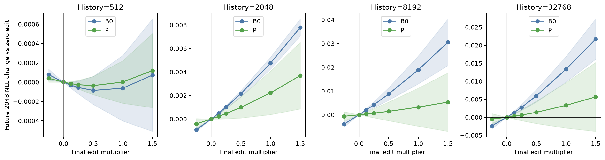
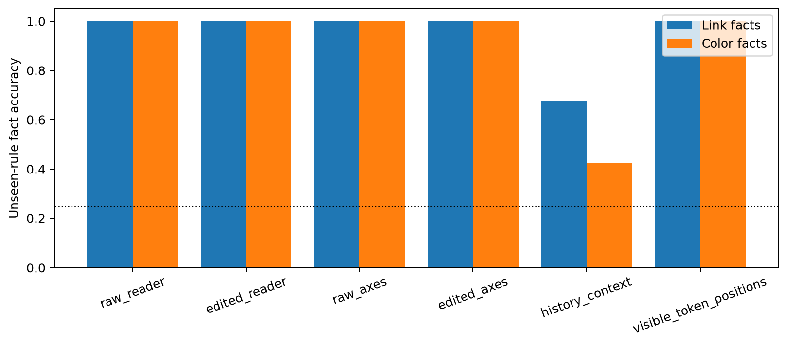
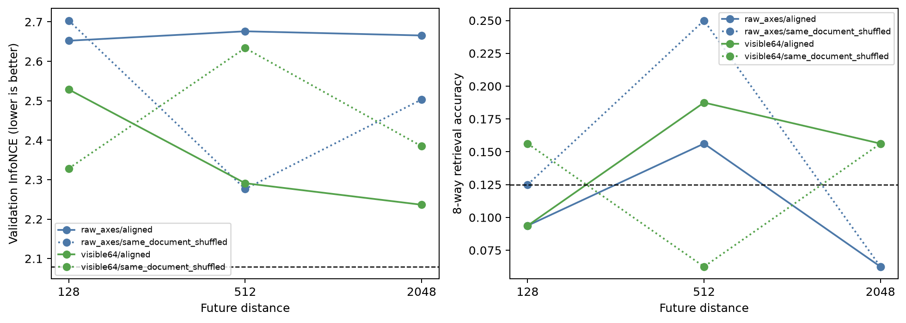

> Historical research record. This public export includes selected reports, numerical tables and figures; original checkpoints/caches are not distributed. Paths below describe the original experiment unless linked to a public file.

# WSR-v0.2a 三项小诊断

使用原检查点与缓存；冻结 Mamba 和 Dream，不启动新一轮正式训练。S 的新计算仅为本次授权的读出诊断，不恢复 S 主训练。S+P、W1/W2 均未启动。所有结论均来自 validation，最终 test 未读取。

## 1. 状态修改幅度扫描

固定八轮输出方向，续算状态为 `H(s)=H0+s*(H8-H0)`。卷积缓存和其他层不变；s=0/1 使用原 FP32 状态端点，避免减加舍入。其余点重新运行后续 LM。B0/P 各三个种子，2048 步检查点。两篇 Wiki（一篇原曲线、一篇曲线外）各两个历史边界，以及两本 PG 各 8K/32K 边界，共八个前缀。没有周期性幅度扫描。

下表为未来 2048 tokens 的 ΔNLL，先对两个文档平均，再对三个种子平均；负值表示改善：

| 组/历史 | −0.25 | 0.125 | 0.25 | 0.5 | 1.0 | 1.5 |
|---|---:|---:|---:|---:|---:|---:|
| B0/512 | +0.0000779 | -0.0000307 | -0.0000549 | -0.0000854 | -0.0000622 | +0.0000724 |
| B0/2048 | -0.0009012 | +0.0004953 | +0.0010189 | +0.0021525 | +0.0047521 | +0.0077859 |
| B0/8192 | -0.0039058 | +0.0020634 | +0.0042081 | +0.0087578 | +0.0189102 | +0.0305620 |
| B0/32768 | -0.0024033 | +0.0013119 | +0.0027465 | +0.0059463 | +0.0133322 | +0.0217151 |
| P/512 | +0.0000405 | -0.0000154 | -0.0000263 | -0.0000356 | +0.0000014 | +0.0001200 |
| P/2048 | -0.0004069 | +0.0002265 | +0.0004676 | +0.0009944 | +0.0022253 | +0.0036933 |
| P/8192 | -0.0006098 | +0.0003335 | +0.0006860 | +0.0014516 | +0.0032359 | +0.0053539 |
| P/32768 | -0.0004938 | +0.0002837 | +0.0006066 | +0.0013794 | +0.0033094 | +0.0056603 |

阴影是三个种子的标准差，不是文档总体置信区间。CSV 同时提供未来 64/512/2048 和实际相对编辑范数；所有扫描点均展示，不以 validation 的最优点替换正式配置。两个 Wiki 文档的结果不代表全部 Wiki 验证集。

**判断：**缩小幅度确实减少 B0 的长历史损害，但 8K/32K 上正向 0.125 仍有退化，反向 −0.25 反而改善。过度改写不是充分解释；编辑方向在长历史分布下也不合适。短历史允许小幅正向收益，存在历史/文本依赖。P 缓解损害，但长历史均值也没有稳定的正向有益区间。未据此修改任何训练模型或部署缩放系数。

## 2. S 的三级信息读取

一级：直接解析实际可见文本，并核对原规则标签；1280 个训练/验证规则均精确对齐，确定性查询执行 100%。另对按 token 位置保留的冻结 embedding 投影训练线性事实读出，检验输入信息的可学习性。

二级：原始 SSM；三级：原 S-seed0 的八轮改写状态。两层分别读取既有 QueryDecoder 的冻结 128 维 StateReader 输出，以及保持头/P 通道位置的固定随机 N 维投影（128→8 后展平，含逐头尺度，共 12312 维）。没有改变正式 Dream 架构。另读出冻结历史 GRU 的最终 64 维上下文。

探针只预测四条链接和四个基础颜色，1024 训练规则、256 个未见规则；正则从训练规则内部 768/256 划分选择，再拟合全训练集。标签只参与探针拟合。查询答案由预测事实执行确定性规则得到，属于信息可读性上界，不是训练出的组合能力。

| 读出 | 链接事实 | 颜色事实 | 八事实全对 | 未见查询，符号执行 |
|---|---:|---:|---:|---:|
| raw_reader | 100.00% | 99.90% | 99.61% | 99.90% |
| edited_reader | 100.00% | 99.90% | 99.61% | 99.90% |
| raw_axes | 100.00% | 100.00% | 100.00% | 100.00% |
| edited_axes | 100.00% | 100.00% | 100.00% | 100.00% |
| history_context | 67.58% | 42.29% | 0.00% | 35.25% |
| visible_token_positions | 100.00% | 100.00% | 100.00% | 100.00% |

打乱训练规则标签后，验证事实读出回到随机附近；32 样本拟合对大多数读出为 100%，历史 GRU 上未完全拟合。固定文本格式、原规则划分与单一模型种子的限制保留；失败的线性读出不能证明完全没有信息。

读出头对照：对原始 reader、改写 reader，以及显式基础事实 one-hot（特权正对照）分别重新训练同结构查询 MLP；只训练新头，原 reader 和 Dream 不更新。每头 512 步、batch16、八查询，65536 查询标签 draws，是原 S 单种子查询监督 draws 的四倍；三种输入用同初始化、样本日程与预算。

| 查询头输入 | 训练规则/已见查询 | 新规则/已见查询 | 新规则/未见查询 |
|---|---:|---:|---:|
| raw_reader | 54.04% | 51.56% | 52.73% |
| edited_reader | 53.70% | 51.51% | 52.44% |
| oracle_facts | 55.48% | 53.71% | 51.66% |

新规则/未见查询的可见颜色频率捷径为 53.91%；这些新查询头约 52%，仍未超过该捷径。原正式 S 头同集合为 25.88%。

**判断：**信息已经存在于原始 SSM，甚至现有 StateReader 的低维输出也足够线性恢复事实。Dream 没有增加事实读出价值。主要瓶颈至少包含下游查询学习/关系组合，而不是单纯缺少事实。显式历史 GRU 较弱仍是局部问题，但不能用它解释 S 的全部失败；也不能据此归因于缺少工作区。特权事实和符号执行的成功不代表 Dream 学会了中间计算。

## 3. P 的未来特征可预测性

使用原三个距离 128/512/2048、原冻结未来编码器/特征标准化/InfoNCE 温度 0.1，每个正确片段配七个同文档、相互不重叠的困难负样本。每个前缀固定一套候选，各读出共享；均匀 CE=ln(8)=2.07944，随机化 top1 期望 12.5%。训练 860 个前缀、144 文档；验证 32 个前缀、18 个独立文档，共 96 个相关距离查询。

输入：原 P-seed0 的冻结 reader 输出、原始 SSM 的位置保留投影，以及最近 64 个可见 tokens 的冻结编码特征；后者使用与目标相同的独立片段编码器，不含未来。Ridge 从训练文档的 116/28 文档隔离划分选正则，再拟合全训练集。额外 InfoNCE MLP 为 hidden128、512 步、batch32、固定 lr=1e−3/AdamW；只训练新头，不训练 Dream。四个头共 2048 次轻量更新，196608 个距离查询 draws，不能与正式 P 的计算预算等同。

| 读出/训练配对 | 验证 CE | 验证 top1 |
|---|---:|---:|
| 均匀（top1 为随机化期望） | 2.07944 | 12.50% |
| prior_all_train | 2.74195 | 10.42% |
| prior_balanced_datasets | 2.34336 | 16.67% |
| visible64_persistence | 2.83680 | 15.62% |
| future_target_self_match | 0.13572 | 100.00% |
| ridge/raw_reader | 2.61651 | 13.54% |
| ridge/raw_axes | 2.66510 | 13.54% |
| ridge/visible64 | 2.66559 | 10.42% |
| InfoNCE/raw_axes-aligned | 2.66459 | 10.42% |
| InfoNCE/raw_axes-same_document_shuffled | 2.49435 | 14.58% |
| InfoNCE/visible64-aligned | 2.35205 | 14.58% |
| InfoNCE/visible64-same_document_shuffled | 2.44887 | 12.50% |

虚线配对打乱保持文档身份和样本量，只打乱训练文档内部历史—未来关联；验证时另对同文档输入轮换，81.25% 的前缀真正改变，其余单前缀文档保持不动。高容量探针训练准确率可接近 100%，而文档外验证接近随机，说明能记住训练候选不等于学会未来对应关系。

相同文档的聚类 bootstrap（2000 次，18 文档；仍仅单个探针种子）对 InfoNCE CE 的配对变化：

| 对比 | 均值 | 95% 聚类区间 |
|---|---:|---|
| raw_axes-aligned_minus_uniform | +0.58515 | [+0.40899, +0.75051] |
| raw_axes-same_document_shuffled_minus_uniform | +0.41491 | [+0.21241, +0.64763] |
| visible64-aligned_minus_uniform | +0.27261 | [+0.14757, +0.39568] |
| visible64-same_document_shuffled_minus_uniform | +0.36943 | [+0.19685, +0.53775] |
| raw_axes_aligned_minus_shuffled_train | +0.17024 | [-0.04561, +0.39259] |
| visible64_aligned_minus_shuffled_train | -0.09682 | [-0.28692, +0.07758] |

已可见片段的正对照：目标换成最近 64 个可见 tokens 的特征；负样本仍为七个同文档非重叠片段。这是管线正对照，不是未来预测结果。

| 读出 | 已可见目标 CE | 已可见目标准确率 |
|---|---:|---:|
| raw_reader | 1.83310 | 25.00% |
| raw_axes | 1.24467 | 56.25% |
| visible64 | 0.19889 | 100.00% |

**判断：**在本轮数据量、两类新读出头与三个距离下，没有证实可泛化的未来特征可预测性。流程能学到可见目标，未来候选自匹配也为 100%，故不像候选索引或损失链路坏掉；但高容量头明显过拟合，仍无法区分目标本身的条件不确定性、读出器局限和训练文档不足。结果不证明所有历史都不含未来信息。P 对 LM 退化的缓解应继续单独解释，不能归功于已学会未来特征预测。

## 执行边界与复现

原检查点、旧报告和已完成结果的 SHA256 对照见 verification.json；旧文件不覆盖。新增事实/查询/特征头与固定缓存均在本诊断目录。Mamba/Dream 优化器更新均为零，没有 W1/W2、新记忆槽或 S+P。所有扫描/读出均属验证诊断，没有用测试集选参数。

源码和运行方式见项目根目录 WSR_V02A_DIAGNOSTICS.md；完整数值见 results.json、amplitude-detail.csv、S-facts.csv、P-by-distance.csv。图片同时提供 PNG/SVG/PDF。
