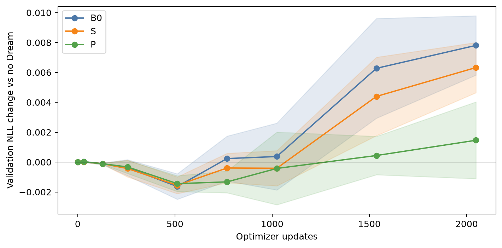
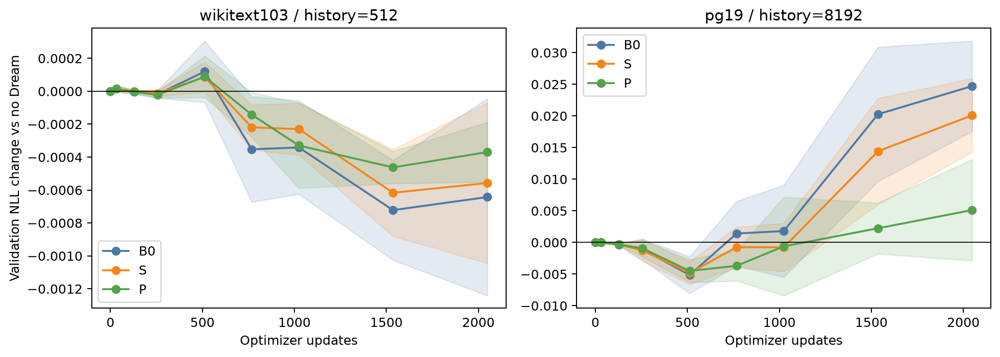
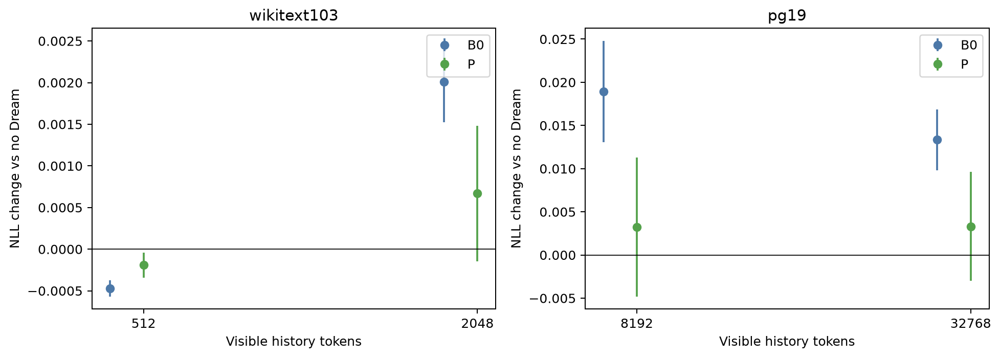
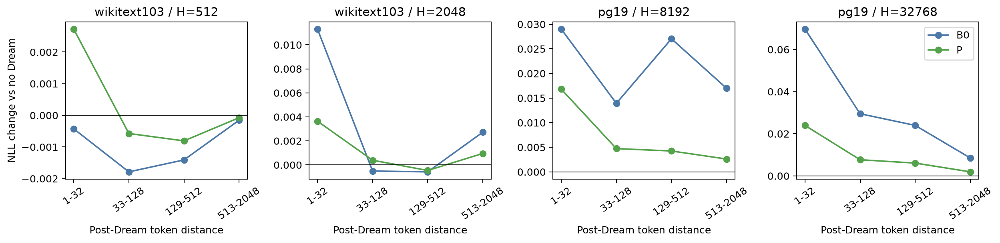
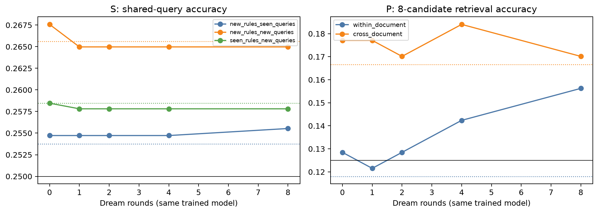
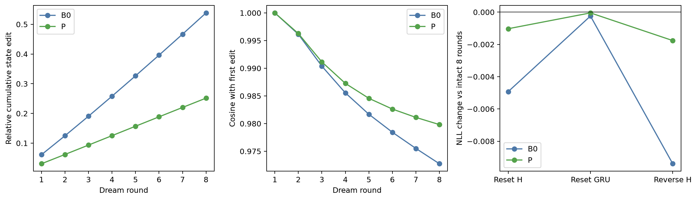
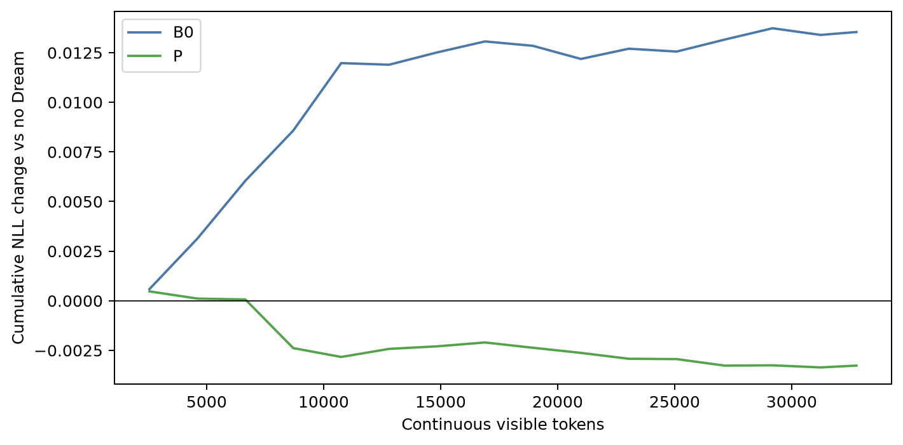

> Historical research record. This public export includes selected reports, numerical tables and figures; original checkpoints/caches are not distributed. Paths below describe the original experiment unless linked to a public file.

# WSR-v0.2a 结果报告

B0/P 各完成三个配对种子、每种子 2048 步训练。S 的三个种子训练与辅助评价在暂停指令前已完成并保留。按最新指令，仅继续 B0/P 扩展语言评价与连续运行，S 不再新增训练或扩展评价。保留 512/1024/2048 检查点、验证曲线和原始逐样本结果。官方 Mamba 参数冻结；仅训练 Direct Dream 和对应辅助头。没有实现 W1/W2 或新记忆槽。

本报告所有语言损失单位为 nats/token；负的配对差值表示改善。结果来自原 validation 划分，测试集未读取。三种子标准差衡量初始化/训练顺序变化，不是文档总体的置信区间。

## 1. 预算与真实语言预测

| 组 | 历史/数据 | ΔNLL 相对无 Dream，均值 ± 种子 SD | 配对 ΔNLL 相对 B0 |
|---|---|---:|---:|
| B0 | wikitext103 / 512 | -0.0004701 ± 0.0000972 | +0.0000000 |
| B0 | wikitext103 / 2048 | +0.0020107 ± 0.0004889 | +0.0000000 |
| B0 | pg19 / 8192 | +0.0189102 ± 0.0058704 | +0.0000000 |
| B0 | pg19 / 32768 | +0.0133322 ± 0.0035474 | +0.0000000 |
| P | wikitext103 / 512 | -0.0001914 ± 0.0001509 | +0.0002787 |
| P | wikitext103 / 2048 | +0.0006686 ± 0.0008141 | -0.0013421 |
| P | pg19 / 8192 | +0.0032359 ± 0.0080295 | -0.0156743 |
| P | pg19 / 32768 | +0.0033094 ± 0.0063003 | -0.0100228 |

未出现在训练曲线面板中的 Wiki 验证文档，两个历史边界合并：

| 组 | ΔNLL 相对无 Dream | 配对 ΔNLL 相对 B0 | 文档数 |
|---|---:|---:|---:|
| B0 | +0.0006584 ± 0.0002188 | +0.0000000 | 12 |
| P | +0.0002353 ± 0.0003336 | -0.0004231 | 12 |

上述短程表包含 16 篇 Wiki validation 文章，长程表包含两本 PG validation 书。每个边界后最多评分 2048 tokens；表内先按文档边界求平均，再跨三个种子求均值。不能把不同历史长度下的差异都归因于历史长度，因为对应的后续文本也不同。

固定曲线面板为四篇 Wiki 文章与两本 PG 书；阴影为三个种子的标准差。所有预算检查点都展示，不以最好点替代 2048 步终点。

短历史 Wiki 与 8K 历史 PG 分开呈现，避免合并平均掩盖方向相反的变化。

各距离点可能包括不同数量的文档：短文档后续不足 2048 tokens 时使用自然可用长度，逐位置与同文档基线配对；未拼接填充。

## 2. 目标函数与权重

`L_LM = mean(-log p(future_64 | modified_state))`；每个更新内两个连续周期再平均。
`L_S = mean_i CE(QueryDecoder(Dream(H,X), q_i), a_i)`，同一组查询共享一次 Dream。
`L_P = CE(normalize(Predictor(H_new,d)) · stop_gradient(normalize(FrozenEncoder(F_candidates))) / 0.1, positive_index)`，三种距离和两个周期再平均。

B0 仅用 L_LM；S 使用 alpha=0.9803735；P 使用 beta=0.27844991。两项权重分别根据 16 个训练样本的初始 Dream 梯度中位数校准，并经过两个候选各八步的训练稳定性试验；不由验证收益选权重。见 calibration.json (`calibration.json`; local archival artifact, not distributed)。正式训练每 256 步记录 LM/辅助梯度范数和夹角。

续算中冻结主模型权重但保留对输入状态的反向路径；编辑后重新计算 anchor 的 logits。未来文本/特征绝不进入 Dream；编码器前向为 no_grad，预测目标不带梯度。辅助任务只监督第八轮，1/2/4 轮为事后读出。

工程修复：有限差分发现辅助 StateReader 对已编辑状态的归一化尺度存在不必要的 detach。已移除并加入沿缩放方向的梯度检查；21 项测试通过。修复前 S/P 各 448 步及其校准被完整归档到 engineering-smoke-reader-stopgrad，不纳入正式对照；S/P 重新校准并从共同初始化训练。B0 与冻结 LM 续算不受该读出头错误影响。见 reader-gradient-diagnostic.json。

## 3. S：共享查询泛化与预测头贡献

四地点链接置换＋颜色事实，查询沿链接走 1–3 步后的终点颜色；四选一，随机准确率 25%，均匀预测 CE=ln(4)≈1.38629。1024 个训练规则实例与 256 个新实例独立；八种训练查询组合与四种留出组合独立。查询解码器只读取状态和分开编码的起点/步数，不读取历史。

| 验证集合 | 独立无 Dream 头 | 联合头读原始状态 | 联合头读 1 轮 | 联合头读 8 轮 | 查询错配 | 颜色频率基线 |
|---|---:|---:|---:|---:|---:|---:|
| new_rules_seen_queries | 25.37% | 25.47% | 25.47% | 25.55% | 25.55% | 52.00% |
| new_rules_new_queries | 26.56% | 26.76% | 26.50% | 26.50% | 24.41% | 53.91% |
| seen_rules_new_queries | 25.85% | 25.85% | 25.78% | 25.78% | 25.85% | 54.04% |

独立无 Dream 头与联合头同初始化、同样本查询、同更新数和学习率；它只在未编辑状态上训练。联合头读原始状态是另一个同头消融。新查询验证不会给 Dream 提供查询或答案，已见规则集合只从实际采样过的训练规则中选取。

颜色频率基线直接根据可见事实选最常见颜色，忽略链接和查询；它可能明显高于 25%。查询错配则保持编辑状态不变，把查询循环置换后仍对原标签评分。只有超过这些捷径并表现出查询依赖，才更支持关系组合能力，不能仅凭高于随机准确率判断。

进一步的数据级捷径检查：在新规则/新查询上，直接取起点颜色为 56.15%，始终只走一步、忽略所请求步数为 67.87%。这些基线直接获得可见结构事实，用来揭示任务捷径，不是同容量的神经状态读出器。它们再次说明高于随机准确率不足以证明多步组合。

S 的历史通路诊断（每种子 32 个未见规则，不更新参数）：

| 检查点 | 颜色词上的历史梯度质量 | 最后 16 tokens 上的梯度质量 | 只置换颜色词时最大概率变化，均值 |
|---|---:|---:|---:|
| 0 | 0.000231% | 99.9465% | 1.85e-08 |
| 2048 | 0.000472% | 99.9045% | 2.27e-08 |

这里保持原始 SSM 不变，只对显式历史 embedding 通路求梯度/置换颜色词。规则全文 94 tokens 完整可见；末尾 16 tokens 是通用任务说明。这个诊断衡量该通路对事实的敏感度，不检验原始 SSM 究竟保留了多少信息；弱敏感度是当前读取链路的瓶颈线索，不能据此否定 S 目标或证明必须增加工作区。详见 S-history-sensitivity.json。

## 4. P：未来预测、困难负样本与捷径

FrozenEncoder 为同一冻结 Mamba 的最终归一化隐藏表示，独立编码每个 64-token 未来片段后均值池化。特征使用训练集统计做逐坐标标准化再 L2 归一化。每个正确未来配七个同文档且不与正确片段重叠的负样本，候选乱序；随机准确率 12.5%，均匀预测 CE=ln(8)≈2.07944。距离为 128、512、2048。

| 候选方式 | 独立无 Dream 头 | 联合头读原始状态 | 联合头读 1 轮 | 联合头读 8 轮 | 目标错配 |
|---|---:|---:|---:|---:|---:|
| within_document | 11.81% | 12.85% | 12.15% | 15.62% | 11.81% |
| cross_document | 16.67% | 17.71% | 17.71% | 17.01% | 8.68% |

同文档困难候选按距离分解：

| 未来距离 | 独立无 Dream 头 | 联合头读原始状态 | 联合头读 8 轮 | 仅距离训练先验 | 候选中心性 | CE：8轮−原始 |
|---|---:|---:|---:|---:|---:|---:|
| 128 | 12.50% | 16.67% | 13.54% | 15.62% | 12.50% | +0.01841 |
| 512 | 9.38% | 11.46% | 13.54% | 25.00% | 12.50% | +0.06285 |
| 2048 | 13.54% | 10.42% | 19.79% | 15.62% | 21.88% | +0.00893 |

对同一联合头，读取第八轮状态相对原始状态的差异，才直接衡量该头是否从编辑中获益。跨文档负样本更容易通过主题识别完成；它只作为捷径诊断，训练始终用同文档困难负样本。目标错配破坏输入与正确标签的关联。候选重复读出与三个距离不是完全独立样本，见逐距离 CSV。

“仅距离训练先验”从训练目标特征求每个距离的固定均值原型，Wiki/PG 各占一半，不读取当前历史或状态；“候选中心性”仅根据当前候选集合选中心向量，不读取状态，也不作为正式预测器。两者用于检查分布/采样捷径，后者不是合法的状态预测头。

特征塌缩检查：

| 划分 | 特征数 | 范数范围 | 有效秩 | 第一主成分能量 | 同文档/跨文档平均 cosine |
|---|---:|---|---:|---:|---|
| train | 7226 | 1.000000–1.000000 | 55.95 | 0.121 | 0.484 / 0.006 |
| validation | 469 | 1.000000–1.000000 | 40.95 | 0.134 | 0.456 / 0.010 |

目标向量自匹配：训练 2580 组、验证 96 组均为 100%；正负特征 cosine>0.999 的比例为 0。这个检查验证候选标签对齐和特征可区分性，不说明真实未来能由当前历史唯一确定。

P 预测输出也按距离单独检查，避免距离 embedding 本身掩盖跨状态塌缩：

| 状态/头 | 距离 | 输出有效秩，三种子均值 | 跨状态平均 cosine |
|---|---:|---:|---:|
| 0 | 128 | 5.89 | 0.8292 |
| 0 | 512 | 5.86 | 0.8642 |
| 0 | 2048 | 5.72 | 0.9217 |
| 8 | 128 | 5.73 | 0.7599 |
| 8 | 512 | 5.65 | 0.7984 |
| 8 | 2048 | 5.39 | 0.8869 |
| no_Dream_trained_head | 128 | 5.69 | 0.7989 |
| no_Dream_trained_head | 512 | 5.49 | 0.8505 |
| no_Dream_trained_head | 2048 | 5.39 | 0.9159 |

相同 32 个验证前缀、逐距离匹配的真实目标特征对照：

| 距离 | 目标有效秩 | 目标跨样本 cosine |
|---|---:|---:|
| 128 | 19.12 | 0.0105 |
| 512 | 19.48 | 0.0109 |
| 2048 | 18.10 | 0.0267 |

这组对照与预测输出使用相同样本数和边界。预测向量较目标明显集中，提示部分输出塌缩/原型化；并非所有输出完全相同，也不能仅凭它断言瓶颈来自 Dream 而不是预测头。见 matched-P-target-diagnostics.json。

图中虚线为独立训练的无 Dream 预测头，实线为联合头在同一已训练 Dream 不同轮次状态上的读出。辅助任务改善不等于真实 LM 改善。

## 5. 多轮计算与中间干预

| 组 | 1 轮 NLL | 2 轮 | 4 轮 | 8 轮 | 单轮方向、匹配八轮幅度 | 8−1 |
|---|---:|---:|---:|---:|---:|---:|---:|
| B0 | 3.0429913 | 3.0434760 | 3.0447967 | 3.0487589 | 3.0462496 | +0.0057676 |
| P | 3.0426673 | 3.0427224 | 3.0429122 | 3.0436177 | 3.0430544 | +0.0009504 |

这些是同一个训练为八轮的模型的提前读出，不是分别训练的单轮与多轮模型。轮数增加也增加累计编辑幅度，收益不能单独归因于循环记忆。

| 组 | 第四轮后干预 | ΔNLL，未来 512，相对完整八轮 | 最终状态差/原状态范数 | 下一轮编辑与原编辑 cosine |
|---|---|---:|---:|---:|
| B0 | reset_state | -0.0049281 | 0.27094 | 0.99737 |
| B0 | reset_memory | -0.0002421 | 0.02259 | 0.98792 |
| B0 | reverse_state | -0.0093958 | 0.54172 | 0.98493 |
| P | reset_state | -0.0010288 | 0.12241 | 0.99911 |
| P | reset_memory | -0.0000477 | 0.01128 | 0.98573 |
| P | reverse_state | -0.0017626 | 0.24484 | 0.99637 |

reset_state 只把 H 还原为最初状态，保留 GRU 记忆；reset_memory 只清空 GRU，保留 H；reverse_state 反转前四轮累计修改。随后继续原第 5–8 轮，不训练新模块。最终状态、下一轮编辑和 LM 损失的变化可证明计算依赖；只有同时带来有益预测，才支持有用中间计算的解释。

每组每种子还保存一个 Wiki 和一个 PG 历史的完整八轮 SSM、GRU 记忆与干预后最终状态，见 evaluation/*/state-trajectories.pt；其余文档保留逐轮范数与方向诊断，可由检查点及原始前缀缓存重建。

## 6. 连续 Wake–Dream

seed=0 在两本 PG validation 书上，从 512-token 历史起每 2048 tokens 重组，连续到 32K，书内不重置缓存。表内按整段相同位置比较无 Dream。

| 组 | 两本书平均 ΔNLL |
|---|---:|
| B0 | +0.0135411 |
| P | -0.0032662 |

周期曲线同时受具体文本变化影响；不把累计收益曲线变平称为状态动力学收敛。长程仅评价，没有长程梯度优化。

## 7. 实际预算与资源

| 组 | 每种子目标 tokens | 主优化器更新 | 独立头对照更新 | 实际 LM 续算 tokens | 训练步骤秒数均值 | 目标 tokens/秒 | 峰值分配显存 MiB |
|---|---:|---:|---:|---:|---:|---:|---:|
| B0 | 262144 | 2048 | 0 | 655360 | 951.5 | 281.2 | 1040 |
| S | 262144 | 2048 | 2048 | 655360 | 1070.0 | 245.4 | 1049 |
| P | 262144 | 2048 | 2048 | 655360 | 1057.6 | 248.5 | 1068 |

有效 batch 为一个文档、两个连续周期，128 个 LM 目标；每个周期的梯度长度仍为 64。S 每步另有八个共享查询，P 每步另有六个距离查询。独立无 Dream 头是额外对照，每种子各 2048 次独立更新，不更新 Dream；其计算包含在表内步骤耗时中，验证和保存耗时另在 resources.csv 的 wall 字段记录。训练与 LM 评价使用 GPU FP32，全部辅助读出统一使用 CPU FP32。相同主更新数和 LM tokens 不等于相同总 FLOPs。缓存准备、校准和弃稿成本在 preparation-accounting.json 中分开列出。

每个种子累计监督 262144 个 LM targets，但唯一监督位置为 91542，存在重复采样。PG/Wiki 各占一半更新，而 PG 训练书只有 16 本，PG 短前缀复用更多。resources.csv 同时报告唯一目标数和重复倍数；不能把累计 tokens 当作同等数量的独立数据。

每组实际覆盖的文档数、唯一边界、逐步损失/梯度/耗时见 resources.csv 与 runs/*/training.json；原语料元数据和哈希见 data/manifest.json。旧结果完整性、配对日程、冻结检查和缓存连续性见 verification.json。

## 8. 解释边界与决策

最终研究判断见 [FINDINGS.md](FINDINGS.md)。必须分别回答：头是否学会辅助任务、编辑状态是否优于原始状态、多轮是否优于早期读出、干预是否改变后续计算。不能以其中一项代替其他三项，也不能仅以辅助准确率声称 Dream 学会有效中间计算。

本轮同时扩大了训练文档覆盖，故相对 v0.1 的变化混合了数据覆盖与预算因素；B0 本轮固定语料上的 512→1024→2048 曲线可用于分析预算趋势。只有三个训练种子、16 篇 Wiki 和两本长书；数据按原划分隔离但不是全量 benchmark。未探索 S+P，未实现 W1/W2，未运行 128K。

完整目标、数据生成器、采样、负样本、权重校准和命令见项目根目录 [WSR_V02A.md](../../docs/WSR_V02A.md)。原始 CSV、PNG/SVG/PDF 和 results.json 与本报告并存。
