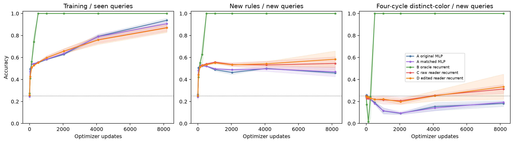
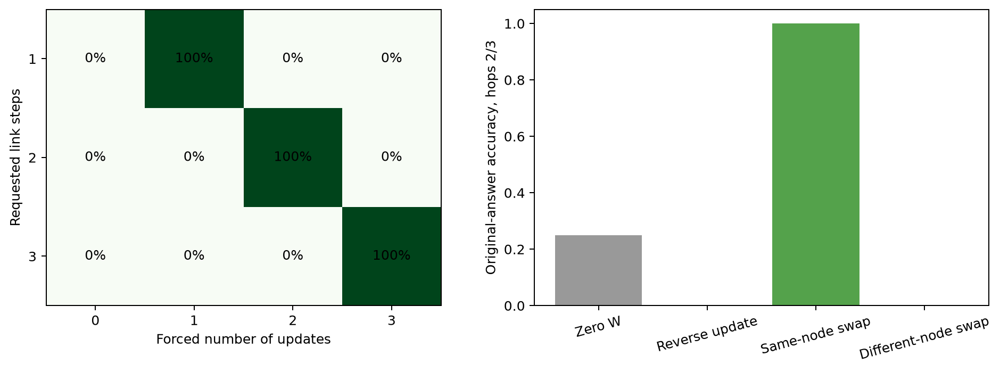

> Historical research record. This public export includes selected reports, numerical tables and figures; original checkpoints/caches are not distributed. Paths below describe the original experiment unless linked to a public file.

# WSR-v0.2b：中间计算链路诊断

本轮只训练新查询网络；官方 Mamba、原 Direct Dream、原 StateReader 全部冻结。原 S 的 1024/256 规则和八个训练/四个留出查询组合保持不变。新增 112 个未见四环、四色互异规则作为排除捷径的诊断集，不进入优化器。所有旧产物保留，test 未读取。

## 四个问题的回答

1. **原 MLP 的低训练准确率首先包含优化/预算不足，但组合泛化不是简单加预算就解决。** 它能完全拟合 32 个规则；加学习率或容量后也能接近/达到完整训练集 100%。然而留出起点×步数组合仍约 45–48%，四色四环上更差。不能说 MLP 理论上无法表达该任务，当前证据指向训练效率与结构归纳偏置。
2. **共享循环网络能在结构化 oracle 输入上，仅靠最终颜色答案学会多步组合。** 三个种子在未见规则、未见查询组合、1/2/3 步及四环诊断上均达到 100%。没有每步节点损失、teacher forcing 或符号链接执行。
3. **直接换成冻结 reader 后只部分保留。** C/D 的最终答案监督必须同时学一个 128→32 的事实读取适配器，泛化明显较弱。加入额外基本事实监督的线性桥接后，冻结 oracle 查询核心恢复约 99.9–100%；这证明信息可用，但这项特权对照不属于 C/D，也不是 Dream 学到的能力。
4. **语义干预支持有用的中间计算，但控制结构是预设的。** 事后可从工作状态解码当前节点；保持当前节点的跨规则状态替换不损害正确率，改成其他节点则沿相应反事实路径输出。地点槽、起点地址以及“走 h 步就执行 h 次更新”均由实现提供。固定三次更新时泛化显著下降，不能声称网络自行发现了执行次数。

## 1. 训练链路与原 MLP 排查

原网络保留输入128（32个事实one-hot＋96个零）、起点/步数各8维 embedding、单隐藏层64、SiLU、四分类输出。所有输入统计只从训练规则估计。32规则过拟合只更新这些规则上的最终答案，初始标准化统计来自原完整训练输入。训练梯度有限非零、参数实际更新。

| 诊断，seed0 | 更新数 | 训练/已见查询 | 新规则/已见查询 | 新规则/新组合 | 四环/新组合 |
|---|---:|---:|---:|---:|---:|
| mlp-original-small32 | 2048 | 100.00% | 43.60% | 42.58% | 22.10% |
| mlp-original-seed0 | 8192 | 91.74% | 81.79% | 45.41% | 21.21% |
| mlp-original-lr0003 | 8192 | 64.15% | 58.94% | 43.65% | 10.27% |
| mlp-original-lr003 | 8192 | 98.93% | 89.21% | 48.05% | 21.43% |
| mlp-capacity128-seed0 | 8192 | 100.00% | 93.75% | 47.95% | 20.76% |

学习率控制为 3e−4 / 1e−3 / 3e−3；容量控制为紧凑事实输入的 hidden128 MLP。三种初始化/样本种子用于主对照。增加预算降低训练误差，却未解决留出组合；不要把训练拟合失败与泛化失败混为一谈。

## 2. 最小循环结构与匹配条件

oracle 的每地点四维链接 one-hot 与四维颜色 one-hot 组成四个8维事实槽。学习的 LayerNorm/线性/SiLU 将每槽变为16维值。可训练地点 embedding 同时用作起点编码和注意力键，初始工作向量另加可训练步数 embedding；这已赋予起点与地点槽的地址结构。循环中以工作向量对地点键做 soft attention，读取事实值，再用同一个 GRUCell 更新工作向量。h 次有效更新后，再做一次学习的注意力读取，由 MLP 输出颜色。没有直接乘链接矩阵，也没有硬编码沿链接更新。

所有三次潜在更新都被展开；超过查询深度的更新被 mask，不改变状态。固定1/3轮对照也提供步数 embedding，但有效更新次数固定。主对照均 Adam lr=1e−3、clip=1、8192次更新、batch16规则×8查询，共1048576个答案 draws；同种子完全相同规则日程。RNN比MLP有更多串行计算，未匹配FLOPs。对照同时改变了事实分槽、地点间共享、注意力和循环结构，未单独隔离参数共享循环的贡献。

原 MLP 名义9596参数，其中oracle零填充对应6144个权重不接收梯度，实际可用3452。紧凑 matched MLP为3081参数，循环oracle为3092参数。C/D另有相同4128参数适配器，共7220；其所有新参数只用最终答案训练。C/D从同种子相同核心及适配器初始化开始，没有复用已训练oracle核心。

## 3. 主对照，三个配对种子

下表均值±种子SD；SD不是规则总体置信区间。

| 条件 | 训练/已见 | 新规则/已见 | 新规则/未见组合 | 四环/未见组合 |
|---|---:|---:|---:|---:|
| A original MLP | 93.81±1.80% | 84.24±2.14% | 45.93±1.08% | 18.15±2.64% |
| A matched MLP | 90.77±1.93% | 81.33±1.51% | 47.01±4.43% | 19.27±0.93% |
| B oracle recurrent | 100.00±0.00% | 100.00±0.00% | 100.00±0.00% | 100.00±0.00% |
| C raw reader recurrent | 87.18±3.54% | 75.46±6.38% | 54.59±6.08% | 31.32±4.09% |
| D edited reader recurrent | 86.93±4.21% | 76.17±6.44% | 58.40±7.49% | 33.41±11.43% |

所有最终结果使用8192步，不按最好验证点替换终点；早期32/128/256/512/1024/2048/4096检查点及状态完整保存。原32规则MLP拟合检查2048步，循环32规则检查4096步，仅作链路检查。

分步数准确率（原256未见规则，三个种子均值）：

| 条件/步数 | 已见查询组合 | 未见查询组合 |
|---|---:|---:|
| A original MLP/1 | 91.67% | 45.44% |
| A original MLP/2 | 79.25% | 41.28% |
| A original MLP/3 | 80.60% | 48.50% |
| A matched MLP/1 | 88.45% | 46.74% |
| A matched MLP/2 | 77.13% | 39.06% |
| A matched MLP/3 | 76.95% | 51.11% |
| B oracle recurrent/1 | 100.00% | 100.00% |
| B oracle recurrent/2 | 100.00% | 100.00% |
| B oracle recurrent/3 | 100.00% | 100.00% |
| C raw reader recurrent/1 | 80.51% | 49.22% |
| C raw reader recurrent/2 | 75.95% | 47.79% |
| C raw reader recurrent/3 | 67.12% | 60.68% |
| D edited reader recurrent/1 | 81.42% | 51.43% |
| D edited reader recurrent/2 | 75.56% | 52.08% |
| D edited reader recurrent/3 | 69.21% | 65.04% |

四环诊断每条规则四色互异、三个目标节点互异且不等于起点；起点颜色捷径为0%，固定一步在2/3步上为0%，均匀及颜色频率的全查询准确率为25%。普通原验证分布的固定一步、颜色频率可明显高于随机，故不能仅以高于25%判断学会组合。data-quality.json 给出规模与标签分布，by-hops.csv 给出逐种子、CE及macro accuracy。

D−C 的配对变化（只是同一个冻结 S-seed0 Dream/reader 上的三个新查询种子，不是三个 Dream 种子）：

- validation_seen: +0.72 个百分点，配对种子SD=0.78；各种子=+0.15, +1.61, +0.39。
- validation_new: +3.81 个百分点，配对种子SD=2.71；各种子=+5.37, +5.37, +0.68。
- balanced_new: +2.08 个百分点，配对种子SD=8.31；各种子=+9.82, +3.12, -6.70。

未见组合上D有小幅一致改善，但四环增益不一致，离oracle仍远。基础事实可读性原本已近乎完整，不能将新网络的整体能力归因于Dream；最多说明这份编辑状态在本设置下改变了后续学习条件。

## 4. 查询敏感性与中间因果作用

改变起点/步数时，只在真实答案应当改变的案例上统计，避免颜色相同导致伪不敏感；完整表见 query-sensitivity.csv。

| 条件 | 改起点：预测变化 | 改起点：新答案正确 | 改步数：预测变化 | 改步数：新答案正确 |
|---|---:|---:|---:|---:|
| A original MLP | 70.24% | 68.83% | 60.25% | 61.63% |
| A matched MLP | 68.26% | 66.82% | 57.93% | 58.29% |
| B oracle recurrent | 100.00% | 100.00% | 100.00% | 100.00% |
| C raw reader recurrent | 66.15% | 64.42% | 57.95% | 58.27% |
| D edited reader recurrent | 66.57% | 66.37% | 61.39% | 60.35% |

oracle循环网络的四环诊断，第一轮后干预，只统计仍需更新的2/3步查询：

| 干预 | 原答案正确率 | 相应反事实答案正确率 |
|---|---:|---:|
| zero | 25.00% | — |
| reverse_first_update | 0.00% | — |
| swap_rules | 95.76% | — |
| preserve_node | 100.00% | 100.00% |
| change_node | 0.00% | 100.00% |

朴素相邻规则替换在四环集上常碰到同一链接映射，因此保留了当前节点，不能把其较小影响解读为状态不重要。追加按真实当前节点筛选的跨规则替换：保留节点时仍正确，改节点时按接收规则的剩余链接执行并命中对应反事实颜色。选择捐赠状态和评分用到的节点标签只用于事后分析；网络没有收到节点标签或符号节点向量。

工作状态的事后线性节点读出在三种子、三轮的四环集上均100%；注意力读取位置也与对应节点吻合。读出相关性单独不足以证明算法，结合反事实状态替换才支持状态承载可用于后续更新的节点内容。地点槽与起点地址已由结构提供，不能把全部节点可解释性称为自发涌现。

强制循环深度：oracle模型在四环集上几乎完全按实际更新次数输出，而不是按原请求步数输出。固定一次/三次更新重新训练的控制（seed0，同8192预算）：

| 控制 | 新规则/已见 | 新规则/未见 | 四环/未见 |
|---|---:|---:|---:|
| recurrent-fixed1-seed0 | 88.53% | 63.87% | 35.71% |
| recurrent-fixed3-seed0 | 99.61% | 58.59% | 20.76% |

因此，循环优势相当程度依赖给定的“h步→h次更新”控制结构。被学到的是在该控制下读取/更新事实和输出颜色的内容；没有证明自主选择计算深度、发现程序控制流或独立工作区的必要性。

## 5. 事实监督桥接，仅作定位

C/D端到端较弱时，追加旧式线性事实探针，将冻结reader的128维输出读成八项事实，再输入冻结的已训练oracle循环核心。探针额外使用1024规则×8事实标签；查询核心复用oracle训练。正则沿用v0.2a诊断的训练内选择。这不是与C/D匹配的最终答案监督实验。

| 来源/划分 | 基础事实正确率 | 冻结oracle核心：未见组合 |
|---|---:|---:|
| raw_reader/validation | 99.95% | 99.90% |
| raw_reader/balanced | 100.00% | 100.00% |
| edited_reader/validation | 99.95% | 99.90% |
| edited_reader/balanced | 100.00% | 100.00% |

这个对照把瓶颈定位为最终答案监督下的表示读取/对齐及联合优化，而不是原始状态缺少事实或oracle查询能力必然无法迁移。C/D学习曲线尚未完全拟合训练集；本轮没有证明它们在更多训练下也必然失败。额外探针或查询网络能力均不计作Dream能力。

## 6. 预算、保存与边界

共22个有界查询训练配置，169984次轻量Adam更新，21757952个重复答案draws；独立事实标签和事后节点探针另列，不能当成新增语言模型tokens。主模型/原Dream/原reader更新均为0。全部新查询训练与分析用CPU FP32；仅112条新诊断文本的冻结特征提取使用GPU。每个主配置8192更新、1048576答案draws，相同更新数不等于相同FLOPs。

原代码/旧检查点/报告的哈希、相同样本日程、C/D相同初始化、梯度和30项测试见 verification.json；每次运行的config/curves/training/schedule/checkpoint均在runs。中间工作状态、注意力与预测见analysis/*/*-states.pt，可从检查点重新计算干预。各组原始逐种子结果、配对差异与CSV并存。

这是有限四节点任务、结构化oracle事实、三个查询训练种子、一个固定旧Dream/reader上的结果。未测试超过3步的长度外推。未进行新的Mamba/Direct Dream训练，未重设计S/P信号，未引入W1/W2或S+P。当前结果说明强归纳偏置下最终答案监督可形成有用中间状态；原始reader到可操作事实的桥接仍是瓶颈。它们不足以单独支持进入独立工作区。
