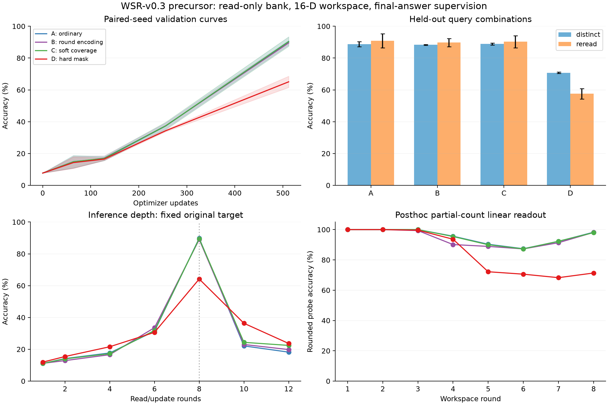

> Historical research record. This public export includes selected reports, numerical tables and figures; original checkpoints/caches are not distributed. Paths below describe the original experiment unless linked to a public file.

# WSR-v0.3 前置实验结论

**本轮没有证据支持将 Coverage 接入 Mamba。** 小型工作区仅靠最终答案学会了有用的加权计数，但软 Coverage 没有稳定提高任务效果；硬读取屏蔽显著损害性能。轮次编码也没有稳定收益。

## 任务与公平性

正式任务为16槽只读二进制库、固定8轮加权计数：一半查询访问8个不同地址，一半为 `a,b,c,d,a,e,f,g`，在第5轮重新利用旧事实。权重含四个1和四个2，最终答案0–12，随机与多数类基线7.69%。模型读当前查询地址/权重，**没有学习自主发现下一个地址**；工作区更新没有硬编码累加，也没有部分和监督。

4组×3配对种子，各512次Adam更新、batch64、16维W、仅最终CE。A/C/D共2733参数，B多128个轮次参数。事实库跨面板不重合，留出组合按完整查询hash隔离。同查询池新实例不保证具体查询曾在训练中出现。

## 主结果：留出查询组合

均值±三种子SD；不是总体置信区间。

| 组 | 训练准确率 | 连续新读 | 返回重读 | 总准确率 |
|---|---:|---:|---:|---:|
| A 普通循环 | 90.57±2.44% | 88.72±1.55% | 90.90±4.42% | **89.81±2.99%** |
| B 轮次编码 | 89.84±1.12% | 88.33±0.22% | 89.74±2.56% | 89.04±1.33% |
| C 软Coverage | 90.50±2.34% | 88.85±0.67% | 90.26±3.85% | 89.55±2.16% |
| D 硬屏蔽 | 64.39±2.42% | 70.77±0.38% | 57.56±3.27% | 64.17±1.46% |

C−A总准确率配对差为 `+0.77 / −0.96 / −0.58` 个百分点，平均 `−0.26`；B−A为 `+1.35 / −2.31 / −1.35`，平均 `−0.77`。没有稳定正向效应，不应按某个单种子较好判断成功。

## 读取多样性不等于收益

A/B/C 的 top-1 路径都符合显式查询地址；跨任务平均重读率约0.0714、每次7.5个不同槽。C没有增加top-1多样性，但把必要重读槽的平均attention从A的0.906降到0.865。它改变了软读取分配，未改善正确率。

D强制重读率为0、读取8个不同槽，总准确率却下降约25.64个百分点，重读族损害更大。连续新读族也退化，说明硬约束还改变了训练优化和共享网络行为，不能把全部差异都归因于“缺了某一次重读”。也不能据此证明任何实现都无法缓存事实来补偿硬屏蔽。

冻结C后关闭Coverage，平均89.81%；第5轮前清零Coverage，约90.00%；推理时将lambda从1增至4，降到81.54%。这是推理干预，不是不同lambda分别训练的正式对照；它提示更强抑制可能有害，没有证明最优lambda或覆盖全部软Coverage设计。

## 工作区有没有有用的中间计算？

有支持，但与Coverage收益分开：

- 捷径对照：只根据整库1的总数拟合的训练内查表基线为19.62%；读取查询值但忽略权重的计数基线为60.77%，均低于A。它们是数据/计算捷径诊断，不是匹配工作区的额外主训练组。

- A在第4轮读入清零后，准确率从89.81%降到42.44%；替换高attention槽内容降到46.22%，替换低attention槽内容仍为89.81%。说明实际读取的内容参与了有用计算。
- 翻转最后一个槽的值并按权重改变正确答案，A仍有88.78%反事实准确率；翻转首个/重复槽并按出现总权重改答案，约93.14%。说明预测跟随了有意义的事实变化，不只是任意扰动造成输出变化。反事实标签分布与原面板不同，不能据此称模型能力提升。
- 保持地址与事实不变、轮换查询权重时，只在正确答案确实变化的样本上评价，A的新答案准确率约91.17%。它确实使用了权重，而不只是忽略权重计数。
- 事后线性探针从A的第4/8轮W解出正确部分和，留出准确率约95.64%/98.27%。探针使用额外分析标签；标签从未训练工作区，不能将探针本身当作模型发现了可解释变量的充分证明。
- 第4轮后替换W：保持部分和的跨实例替换约76.62%正确；改变部分和后，原答案仅约6.47%，按捐赠部分和计算的反事实答案约72.24%。支持部分计数信息具有可迁移的因果作用。
- 保持部分和替换仍低于原始89.81%，说明W还包含其他运行上下文；不能声称形成了完全解耦的纯符号计数器。

这些结果同样出现在普通A，**不是不对称读取额外造成的能力**。

## 多轮效果与结构先验

A在1/2/4/6/8轮的原任务准确率约11.09%/14.17%/17.69%/31.41%/89.81%；10/12轮降至22.12%/18.21%。前段省略了部分查询读取，后段重复最后地址/权重，目标仍是原8项加权和，不能把这条曲线解释为网络自己学会了何时停止或证明任意增加计算有益。

固定8轮、查询游标和地址键均由实现提供；学到的是读入后的状态变换及最终答案映射。没有随机轮数训练、提前停止机制或辅助监督退火。

## 任务筛选与局限

本轮先保留了四项未通过普通A学习门槛的寻址/仿射组合预试验，又保留了达到天花板的4轮计数正对照，再确定8轮加权主任务。它们均留有数据、源码与日志，没有拿预试验最终模型test来选任务。完整过程见仓库根目录 `WSR_V03_PRE.md`。

因此当前结论只针对已知查询地址的有限加权计数、固定预算、lambda=1/rho=0.9与三个种子。它不回答自主内容寻址能否从Coverage受益，也不排除其他数据分布、强度或容量下的收益。

**决策：暂不接入 Mamba，不启动大规模 WSR-v0.3；也不叠加随机轮数或辅助监督退火。** 当前结果证明普通循环工作区可以形成有用中间状态，同时否定了“减少重复读取就自然带来计算收益”在本设置下的推断。

完整数表与干预数据见 [REPORT.md](REPORT.md)、results.json (`results.json`; local archival artifact, not distributed)、[main-results.csv](main-results.csv)、`analysis/`。

