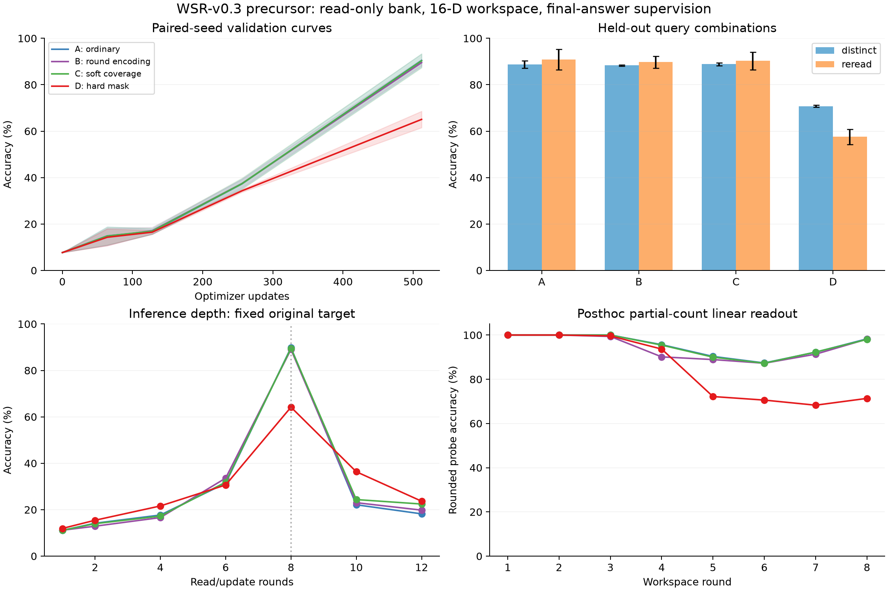

> Historical research record. This public export includes selected reports, numerical tables and figures; original checkpoints/caches are not distributed. Paths below describe the original experiment unless linked to a public file.

# WSR-v0.3 前置：只读信息库与多轮工作区

三配对种子，A 普通 / B 轮次编码 / C 软 Coverage / D 硬 top-1 读取屏蔽。仅最终计数 CE。

| 组 | 参数量 | 训练准确率 | 同查询池新实例 | 留出查询组合 distinct | 留出查询组合 reread | 留出查询组合总准确率 |
|---|---:|---:|---:|---:|---:|---:|
| A | 2733 | 90.57 ± 2.44% | 91.67 ± 2.69% | 88.72 ± 1.55% | 90.90 ± 4.42% | 89.81 ± 2.99% |
| B | 2861 | 89.84 ± 1.12% | 91.15 ± 2.01% | 88.33 ± 0.22% | 89.74 ± 2.56% | 89.04 ± 1.33% |
| C | 2733 | 90.50 ± 2.34% | 91.67 ± 2.65% | 88.85 ± 0.67% | 90.26 ± 3.85% | 89.55 ± 2.16% |
| D | 2733 | 64.39 ± 2.42% | 66.92 ± 1.85% | 70.77 ± 0.38% | 57.56 ± 3.27% | 64.17 ± 1.46% |

均值 ± 三个初始化/训练日程种子的样本 SD，不是总体置信区间。最终检查点统一512步，不按最佳验证点替换。

## 读取行为与因果诊断

| 组 | top-1 重读率 | 不同读取槽数 / 8 | 参考路径 top-1 一致率 | 重读任务正确槽 attention | 中途 evidence 清零后准确率 |
|---|---:|---:|---:|---:|---:|
| A | 0.071 | 7.500 | 1.000 | 0.906 | 42.44% |
| B | 0.071 | 7.500 | 1.000 | 0.907 | 42.44% |
| C | 0.071 | 7.500 | 1.000 | 0.865 | 43.08% |
| D | 0.000 | 8.000 | 0.921 | 0.000 | 45.83% |

## 计算轮数

| 组 | 1轮 | 2轮 | 4轮 | 6轮 | 8轮（训练值） | 10轮 | 12轮 |
|---|---:|---:|---:|---:|---:|---:|---:|
| A | 11.09% | 14.17% | 17.69% | 31.41% | 89.81% | 22.12% | 18.21% |
| B | 11.15% | 12.88% | 16.60% | 33.59% | 89.04% | 23.01% | 19.81% |
| C | 11.09% | 13.97% | 17.24% | 31.86% | 89.55% | 24.36% | 22.44% |
| D | 11.92% | 15.45% | 21.60% | 30.64% | 64.17% | 36.35% | 23.65% |

## 解释边界

- 提供固定八轮和当前查询地址/权重游标；状态更新学习加权计数，没有提供正确部分和或硬编码累加。
- 只读原始库不被擦除；Coverage 改变读取分数，硬屏蔽仅排除历史 attention argmax 槽。软 attention 的其余内容不等于从未读取。
- 参考路径只用于验证标签与事后分析。重复参考访问表示标准执行会重读；网络可能缓存事实，不是证明任何算法都必须物理重读。
- C 的 lambda=1、rho=0.9 预先固定；没有根据读取多样性选择配置。C/D 另有16维机制状态，W容量均16；B额外128参数。
- 所有查询均训练八轮；B在额外轮数复用第八轮编码，地址复用最后一个查询地址。深度曲线不是独立训练的等预算单轮对照。
- 中途干预改变预测只能说明依赖；需结合准确率、反事实计数跟随及高/低读取槽对照判断依赖是否有用。
- 没有加载、更新或连接 Mamba/Direct Dream，没有随机轮数训练或辅助监督退火。
- “同查询池新实例”只表示查询hash bucket在训练允许集合，不保证该具体查询曾出现；留出组合bucket与训练严格不相交。

