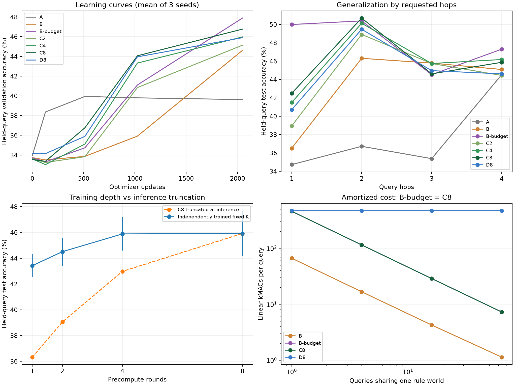

> Historical research record. This public export includes selected reports, numerical tables and figures; original checkpoints/caches are not distributed. Paths below describe the original experiment unless linked to a public file.

# WSR-v0.3：无查询预计算实验报告

本报告使用统一2048更新终点、3个配对初始化种子；没有按测试集选择模型。所有训练只用最终颜色CE，未加载Mamba或旧Dream。

## 任务、目标函数与接口

随机6节点有向函数图，每节点一条非自环出边、一个颜色；三色各两节点。查询为起点s及1–4跳，答案为终点颜色。输入仅基础出边/颜色one-hot；标签由生成器计算，不把路径、传递关系或答案表输入模型。

`W = Precompute(raw_facts)`；随后才提供多个查询，`L = mean CE(W[s] @ head_weight[h] + head_bias[h], answer)`。D在初始化及每轮更新中额外输入查询，为每个查询分别计算。

W为6×32自由特征；按起点选择输出位置和按步数选择线性分类器是预设接口，不含查询阶段隐藏层或循环。B/C每轮的全局MLP都同时看到全部规则及全部W，任何一轮都可完成任意关系组合，不限制一轮一跳。所有可训练参数由最终CE更新；无事实对齐、中间状态标签或辅助损失。读取头的表达能力和查询隔离已单元验证。

训练/验证/测试分别有1024/128/128个互不重复的出边图；三种颜色轮换不跨划分，共3072/384/384实例。每个具体查询的三类答案等频，随机及多数类准确率33.33%。24个起点×步数组合中16个训练、8个留出，所有起点/步数分别都出现于训练。三个种子共享固定数据，SD是初始化/训练差异，不是新数据集总体置信区间。

## 模型效果：测试规则均未见

| 模型 | 参数 | 训练规则/训练查询 | 训练规则/留出查询 | 新规则/训练查询 | 新规则/留出查询 | 优化训练耗时，秒 |
|---|---:|---:|---:|---:|---:|---:|
| A | 396 | 38.81 ± 0.15% | 37.75 ± 0.05% | 37.61 ± 0.24% | 37.84 ± 0.15% | 1.95 ± 0.21 |
| B | 67,404 | 65.69 ± 0.42% | 44.42 ± 0.45% | 61.57 ± 0.30% | 43.42 ± 0.91% | 4.38 ± 0.25 |
| B-budget | 460,748 | 71.64 ± 0.37% | 48.63 ± 0.69% | 63.52 ± 1.08% | 48.06 ± 1.29% | 9.92 ± 0.45 |
| C2 | 67,404 | 67.42 ± 0.27% | 45.62 ± 0.50% | 62.70 ± 0.67% | 44.51 ± 1.10% | 5.18 ± 0.25 |
| C4 | 67,404 | 69.82 ± 0.31% | 46.43 ± 0.96% | 63.59 ± 0.85% | 45.89 ± 1.29% | 6.63 ± 0.39 |
| C8 | 67,404 | 72.00 ± 0.96% | 47.20 ± 1.31% | 64.43 ± 1.07% | 45.92 ± 1.77% | 9.56 ± 0.27 |
| D8 | 70,604 | 70.85 ± 0.86% | 45.57 ± 0.47% | 63.45 ± 0.13% | 44.94 ± 0.80% | 21.23 ± 0.22 |

B就是C1的精确等价实现与结果，未重复训练。B/C具有相同参数量和工作区；B-budget扩大单次MLP宽度以匹配C8预计算线性MACs，其参数量更大。D8在每个查询上执行8轮，训练计算量约为共享预计算的8倍，因此不把其准确率差作为相同总成本的胜负。

| 模型 | 留出组合1跳 | 2跳 | 3跳 | 4跳 |
|---|---:|---:|---:|---:|
| A | 34.72 ± 0.60% | 36.72 ± 0.00% | 35.37 ± 0.49% | 44.53 ± 0.00% |
| B | 36.50 ± 2.12% | 46.31 ± 1.81% | 45.79 ± 0.94% | 45.10 ± 3.35% |
| B-budget | 50.00 ± 4.43% | 50.39 ± 0.45% | 44.53 ± 0.26% | 47.31 ± 0.91% |
| C2 | 38.93 ± 2.17% | 48.91 ± 1.55% | 45.75 ± 1.51% | 44.44 ± 3.47% |
| C4 | 41.49 ± 2.94% | 50.13 ± 2.13% | 45.75 ± 0.08% | 46.18 ± 2.22% |
| C8 | 42.49 ± 3.94% | 50.69 ± 1.48% | 44.62 ± 0.84% | 45.88 ± 2.55% |
| D8 | 40.71 ± 1.54% | 49.48 ± 0.69% | 44.97 ± 1.56% | 44.62 ± 1.95% |

### C8的配对差异（百分点）

| 对照 | 查询组合 | seed0 | seed1 | seed2 | 均值 |
|---|---|---:|---:|---:|---:|
| C8 - A | seen_query | +28.32 | +26.29 | +25.86 | +26.82 |
| C8 - A | held_query | +9.44 | +5.99 | +8.82 | +8.08 |
| C8 - B | seen_query | +3.87 | +2.73 | +1.97 | +2.86 |
| C8 - B | held_query | +3.06 | +1.50 | +2.93 | +2.50 |
| C8 - B-budget | seen_query | +0.90 | +0.93 | +0.91 | +0.91 |
| C8 - B-budget | held_query | -1.07 | -2.83 | -2.51 | -2.14 |
| C8 - C2 | seen_query | +2.23 | +1.86 | +1.11 | +1.73 |
| C8 - C2 | held_query | +1.56 | +0.52 | +2.15 | +1.41 |
| C8 - C4 | seen_query | +1.14 | +1.11 | +0.28 | +0.84 |
| C8 - C4 | held_query | +0.13 | -0.59 | +0.55 | +0.03 |
| C8 - D8 | seen_query | +2.16 | +0.41 | +0.36 | +0.98 |
| C8 - D8 | held_query | +2.67 | -1.99 | +2.25 | +0.98 |

## 轮数：独立训练与推理截断分别报告

| 独立训练的固定轮数 | 新规则/训练查询 | 新规则/留出查询 |
|---|---:|---:|
| 1 | 61.57 ± 0.30% | 43.42 ± 0.91% |
| 2 | 62.70 ± 0.67% | 44.51 ± 1.10% |
| 4 | 63.59 ± 0.85% | 45.89 ± 1.29% |
| 8 | 64.43 ± 1.07% | 45.92 ± 1.77% |

| 固定训练8轮的模型 | 推理轮数 | 新规则/训练查询 | 新规则/留出查询 |
|---|---:|---:|---:|
| C8 | 1 | 43.78 ± 0.59% | 36.33 ± 1.16% |
| C8 | 2 | 52.78 ± 1.63% | 39.05 ± 0.87% |
| C8 | 4 | 61.19 ± 1.28% | 42.98 ± 1.74% |
| C8 | 8 | 64.43 ± 1.07% | 45.92 ± 1.77% |
| D8 | 1 | 43.20 ± 1.54% | 36.55 ± 1.24% |
| D8 | 2 | 52.24 ± 1.81% | 38.91 ± 1.25% |
| D8 | 4 | 61.01 ± 0.90% | 42.48 ± 1.39% |
| D8 | 8 | 63.45 ± 0.13% | 44.94 ± 0.80% |

截断推理是分布变化，不能替代独立训练轮数对照，也不证明自主停止。各轮更新幅度/方向仅作动力学描述，不能由状态变化推出有用分工。

## 成本与预计算复用

以下为稠密线性MACs（1乘加计1MAC，不等于精确硬件FLOPs），排除one-hot、索引、SiLU、LayerNorm与偏置。实测为CPU FP32单线程、batch16向量化、预热3次、9次中位数，再跨种子取均值；包括整个前向，不含反传。训练耗时是优化更新耗时之和，不含评价/检查点/I/O。

| 模型 | 查询数 | 总MACs/规则 | MACs/查询 | 总毫秒/规则 | 微秒/查询 |
|---|---:|---:|---:|---:|---:|
| A | 1 | 96 | 96.0 | 0.010 | 9.62 |
| A | 4 | 384 | 96.0 | 0.013 | 3.15 |
| A | 16 | 1,536 | 96.0 | 0.013 | 0.81 |
| A | 64 | 6,144 | 96.0 | 0.019 | 0.30 |
| B | 1 | 66,528 | 66,528.0 | 0.019 | 18.87 |
| B | 4 | 66,816 | 16,704.0 | 0.018 | 4.54 |
| B | 16 | 67,968 | 4,248.0 | 0.022 | 1.37 |
| B | 64 | 72,576 | 1,134.0 | 0.035 | 0.55 |
| B-budget | 1 | 458,976 | 458,976.0 | 0.047 | 46.64 |
| B-budget | 4 | 459,264 | 114,816.0 | 0.032 | 7.93 |
| B-budget | 16 | 460,416 | 28,776.0 | 0.047 | 2.95 |
| B-budget | 64 | 465,024 | 7,266.0 | 0.055 | 0.85 |
| C2 | 1 | 122,592 | 122,592.0 | 0.024 | 23.93 |
| C2 | 4 | 122,880 | 30,720.0 | 0.023 | 5.83 |
| C2 | 16 | 124,032 | 7,752.0 | 0.027 | 1.67 |
| C2 | 64 | 128,640 | 2,010.0 | 0.036 | 0.57 |
| C4 | 1 | 234,720 | 234,720.0 | 0.042 | 41.75 |
| C4 | 4 | 235,008 | 58,752.0 | 0.037 | 9.17 |
| C4 | 16 | 236,160 | 14,760.0 | 0.040 | 2.51 |
| C4 | 64 | 240,768 | 3,762.0 | 0.046 | 0.72 |
| C8 | 1 | 458,976 | 458,976.0 | 0.067 | 67.36 |
| C8 | 4 | 459,264 | 114,816.0 | 0.060 | 14.88 |
| C8 | 16 | 460,416 | 28,776.0 | 0.076 | 4.75 |
| C8 | 64 | 465,024 | 7,266.0 | 0.074 | 1.16 |
| D8 | 1 | 471,136 | 471,136.0 | 0.084 | 83.68 |
| D8 | 4 | 1,884,544 | 471,136.0 | 0.123 | 30.72 |
| D8 | 16 | 7,538,176 | 471,136.0 | 0.351 | 21.92 |
| D8 | 64 | 30,152,704 | 471,136.0 | 1.325 | 20.70 |

C成本为一次预计算加Q次轻量读取；D为Q次查询定向计算。在1/4/16/64个查询的计时中没有重复调用C预计算。查询从24个组合中有放回独立抽取；数量增加只是摊销，不改变单个查询的预测函数。本表未启用D的答案缓存；由于只有24个不同查询，若允许按查询键缓存D输出，重复查询无需重算，因此64查询的线性成本不是D可实现的最优成本。实测速度还受向量化/批量大小影响，不能用MAC比直接冒充时延比。所有组训练固定每规则8查询，本轮没有测试训练查询数量的独立作用。

## 数据、捷径与置换诊断

| 简单基线 | 全查询 | 1跳 | 2跳 | 3跳 | 4跳 |
|---|---:|---:|---:|---:|---:|
| start_color | 32.29% | 19.01% | 33.59% | 32.68% | 43.88% |
| always_one_hop | 51.66% | 100.00% | 19.53% | 44.66% | 42.45% |
| majority_color | 33.33% | 33.33% | 33.33% | 33.33% | 33.33% |

固定一步基线使用真实基础出边进行一次符号读取，是任务捷径诊断，不是与轻量读取头同预算的已训练组。短周期会使不同跳数答案相关，必须结合逐跳准确率，不能把超随机准确率直接解释为完整多跳计算。

| 模型 | 节点一致置换后：训练组合 | 节点一致置换后：留出组合 | 全局颜色轮换后：全查询 |
|---|---:|---:|---:|
| A | 36.63 ± 0.22% | 38.98 ± 0.25% | 37.68 ± 0.21% |
| B | 60.66 ± 0.56% | 43.79 ± 0.54% | 55.52 ± 0.50% |
| B-budget | 62.59 ± 1.06% | 46.98 ± 1.49% | 58.37 ± 0.82% |
| C2 | 61.54 ± 0.46% | 44.49 ± 0.57% | 56.64 ± 0.80% |
| C4 | 62.34 ± 0.70% | 45.16 ± 0.88% | 57.69 ± 0.97% |
| C8 | 63.53 ± 0.06% | 45.57 ± 0.86% | 58.26 ± 1.12% |
| D8 | 63.02 ± 0.16% | 44.63 ± 0.86% | 57.28 ± 0.33% |

置换同时修改节点槽、出边目标与查询起点；答案语义保持。上表按映射后的查询组合归属评价，并剔除碰巧匹配训练图的21个实例，保留363个。原8个留出组合中有3个映射成训练组合；原组别汇总仍保留在results.json，但不能当作留出组合不变的比较。全局稠密网络并非结构上置换等变，因此该项检验学习到的泛化而非保证。

面板本身包含全部三种颜色轮换，颜色轮换汇总并不是额外独立的泛化挑战。

## 实验记录、检查与局限

- 只有一个任务配置，没有为C筛选难度或修改任务。32实例B/C8/D8均能100%拟合训练组合；留出组合不是该过拟合检查的验收目标。
- 先512步seed0预实验，再不改任务续训至预先声明的2048步，扩展3种子；预实验计入seed0预算，未重复计数。21个主运行共43,008更新、5,505,024个最终答案监督；小样本检查另外记录。
- 所有模型相同Adam、学习率、梯度裁剪、规则/查询日程与答案数量；这不保证各结构均达到最佳优化状态。没有为B或C单独调参，因此结果只描述当前预算。
- 最终读取位置按起点预设，分类器按步数选择；循环轮数和全局MLP架构也由实现提供。不能声称自主寻址、自主停止或已发现特定逐轮算法。
- 本轮按用户收窄范围，先完成准确率、轮数与预算对照；未加入随机轮数、Anytime、Coverage、轮次编码或新模块。
- 原始产物保护见`preservation-after.json`；代码、协议、曲线、梯度、日程、检查点及全部测试日志保留。

方法：[仓库协议](../../docs/WSR_V03.md)。原始表：[main-results.csv](main-results.csv)、[rounds.csv](rounds.csv)、[costs.csv](costs.csv)、[paired-differences.csv](paired-differences.csv)、[results.json](results.json)。研究决策另见[FINDINGS.md](FINDINGS.md)。
